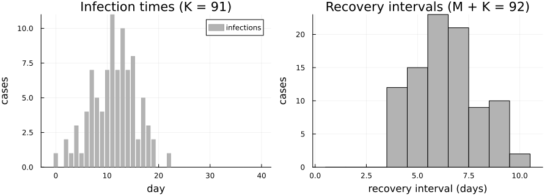
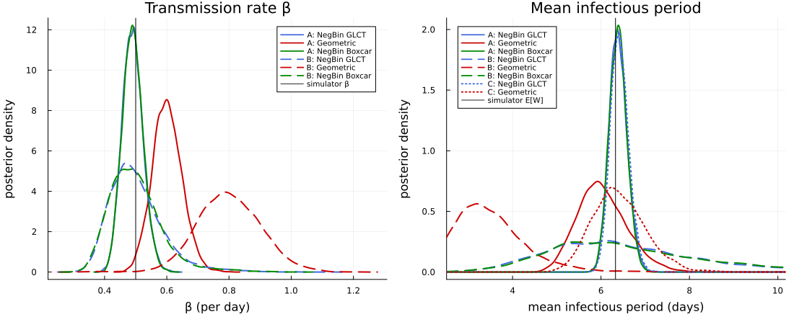
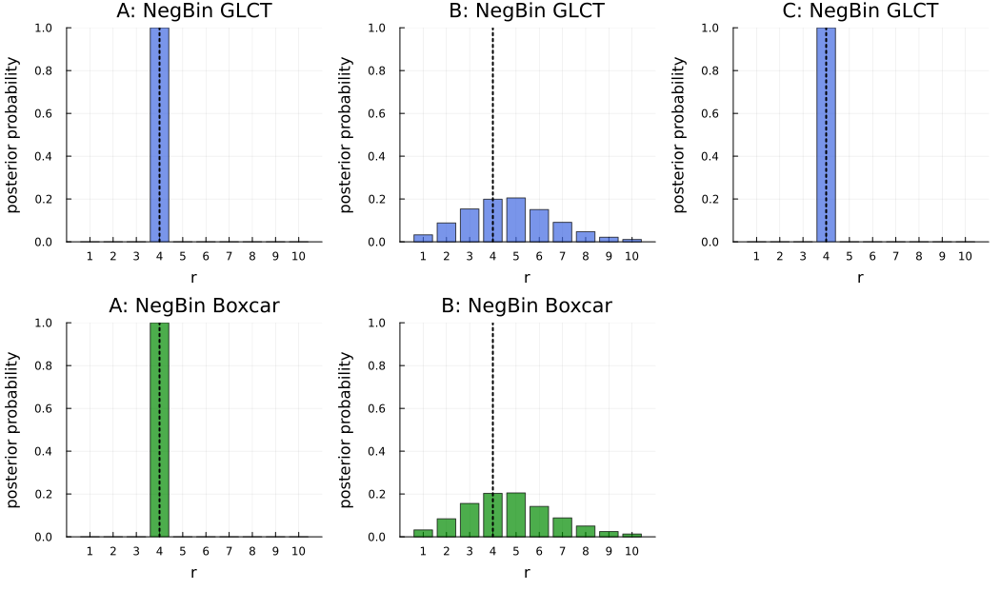
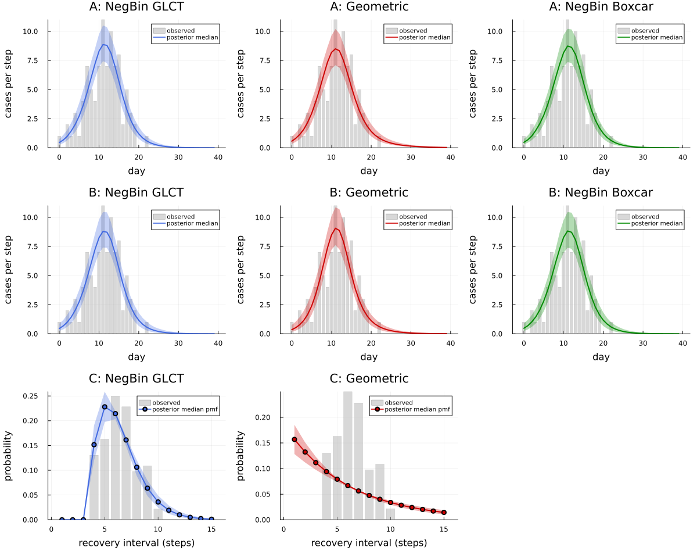

```@meta
EditURL = "data_availability.jl"
```

# Data availability: what each likelihood term contributes

!!! note "Precomputed with the manuscript settings"
    The output on this page was precomputed using the manuscript's MCMC settings and is
    displayed without being re-evaluated. To rerun it, see [Reproducibility](../reproducibility.md).

DDSA splits the log-likelihood of a line list into three parts: the infection-time term ``\ell_I``
(``\text{Multinomial}(K, f)``), the recovery-interval term ``\ell_R`` (a discrete phase-type
infectious period), and the final-size term ``\ell_\text{constr}`` (``K \sim \text{Binomial}(N, \tau)``).
Here ``K`` is the number of cases among the ``N`` individuals at risk; a discrete-time SIR map gives
the expected fraction infected ``\tau`` and the distribution ``f`` of infection times over the
observation window (see the [Guide](../guide.md)).

Line lists are often incomplete: contact tracing may record infection times without follow-up
on recovery, and hospital records may provide durations without specifying infection dates. This vignette
measures what each term contributes by fitting one synthetic line list under three data-availability
scenarios, each with three infectious-period (IP) models: a negative binomial (NegBin) IP propagated
through the GLCT map, the same NegBin IP through a Boxcar (infection-age) map, and a geometric IP.

| Scenario | Observed data | Likelihood | Parameters |
|:---|:---|:---|:---|
| A: full | infection times, recovery intervals, final size | ``\ell_I + \ell_R + \ell_\text{constr}`` | ``\beta``, ``\rho``, ``p``, ``r`` |
| B: infection times only | infection times, final size | ``\ell_I + \ell_\text{constr}`` | ``R_0``, ``\mu``, ``\rho``, ``r`` (geometric: ``\beta``, ``\rho``, ``p``) |
| C: recovery intervals only | recovery intervals | ``\ell_R`` | ``p``, ``r`` |

Here ``\beta`` is the transmission rate per day, ``\rho`` the initially infected fraction, ``p`` the
per-stage progression probability, ``r`` the number of NegBin stages (``r \equiv 1`` for the
geometric IP), ``\mu`` the mean IP and ``R_0 = \beta\mu`` the reproduction number.

````julia
using DiscreteDynamicSurvivalAnalysis
using Distributions, Random, Statistics, DataFrames, Turing
using Plots, StatsPlots, Measures

const FULL = get(ENV, "DDSA_FULL", "false") == "true"
t_start = time()
````

## Inputs: one synthetic line list

The simulator uses an Erlang infectious period with continuous-time mean 4 days and ``k = 4``
stages, in discrete time at ``\Delta t = 1`` day with per-stage progression probability
``1 - e^{-k\Delta t/(4\,\text{days})} = 1 - e^{-1}``. Discretisation lengthens the mean: the
discrete infectious period ``W`` has ``E[W] \approx 6.33`` days. With ``\beta = 0.5`` per day the
implied reproduction number is ``R_0 = \beta E[W] = 3.164``.

These discrete-time values are the targets for the posteriors below.
[`simulate_linelist`](@ref) draws the final size ``K``, the infection-time histogram and
one recovery interval for each of the ``K`` cases and the ``M = 1`` initial infective.

````julia
dph_true = dph_erlang_from_mean(4, 4.0, 1.0)     # k = 4 stages, continuous mean 4 d, Δt = 1 d
β_true, ρ_true, N, nsteps = 0.5, 0.01, 99, 40
sim = simulate_linelist(Xoshiro(1234), dph_true, β_true, ρ_true, N, nsteps)
data = sim.data
EW = mean(dph_true)
R0_true = β_true * EW
(K = data.final_size, EW = EW, R0 = R0_true, mean_interval = mean(data.recovery_intervals),
 shortest_interval = minimum(data.recovery_intervals))
````

````
(K = 91, EW = 6.327906827477306, R0 = 3.163953413738653, mean_interval = 6.413043478260869, shortest_interval = 4)
````

````julia
p_inc = bar(0:(nsteps - 1), data.infection_counts; label = "infections", color = :gray70, linewidth = 0,
            xlabel = "day", ylabel = "cases", title = "Infection times (K = $(data.final_size))")
p_rec = histogram(data.recovery_intervals; bins = 0.5:1:(maximum(data.recovery_intervals) + 0.5), label = "",
                  color = :gray70, xlabel = "recovery interval (days)", ylabel = "cases",
                  title = "Recovery intervals (M + K = $(length(data.recovery_intervals)))")
plot(p_inc, p_rec; layout = (1, 2), size = (900, 320), left_margin = 3mm, bottom_margin = 4mm)
````



## Model configuration

All models use the manuscript's priors and guards. The NegBin models sum ``r`` out of
the likelihood over ``r \in \{1, \dots, 10\}`` (Scenario C: up to the shortest observed
interval, 4). NUTS samples the continuous parameters, and ``r`` is drawn afterwards from its
conditional posterior.

- **Scenario A** and the geometric model of **Scenario B** sample ``(\beta, \rho, p)``;
  **Scenario C** samples only ``p``. The mean IP is ``\mu = r/p``.
- **Scenario B** (NegBin models) samples ``R_0`` and ``\mu`` directly (`parameter =
  :mean_ip`, `transmission = :R0`), with ``p = r/\mu`` and ``\beta = R_0/\mu``. These keep the
  same meaning for every ``r``, which the summed posterior needs to mix well.
- The **Boxcar** models have ``K_\text{age}`` infection-age classes and use the hazard of the NegBin
  distribution conditioned on ``W \le K_\text{age}`` (`truncation = :condition`).
  ``K_\text{age}`` is the 99.9% quantile of the simulator's IP in Scenario A (15 days)
  and of the widest prior IP, a geometric with mean 30 days, in Scenario B (204 days).

````julia
guards = NumericalGuards(τ_bounds = (0.001, 0.999))
K_age = findfirst(k -> cdf(dph_true, k) ≥ 0.999, 1:500)
K_age_B = findfirst(k -> cdf(dph_negative_binomial(1, 1 / 30), k) ≥ 0.999, 1:500)
nb_r_max = 10
nb_r_max_C = minimum(data.recovery_intervals)
prA = (β = Uniform(1e-4, 2.5), ρ = Beta(1, N - 1), p = Beta(1, 1))
prB = (R0 = Uniform(0.5, 5.0), mean_ip = Uniform(1.0, 30.0), ρ = Beta(1, N - 1))
prC = (p = Beta(1, 1),)
inf_only = (:final_size, :infection_times)

specs = [
    "A_negbin"    => DDSAModel(infectious_period = NegBinGLCT(1:nb_r_max), priors = prA, population = N,
                               guards = guards),
    "A_geometric" => DDSAModel(infectious_period = GeometricIP(), priors = prA, population = N, guards = guards),
    "A_boxcar"    => DDSAModel(infectious_period = NegBinBoxcar(1:nb_r_max, K_age; truncation = :condition),
                               priors = prA, population = N, guards = guards),
    "B_negbin"    => DDSAModel(infectious_period = NegBinGLCT(1:nb_r_max; parameter = :mean_ip), priors = prB,
                               transmission = :R0, population = N, guards = guards, terms = inf_only),
    "B_geometric" => DDSAModel(infectious_period = GeometricIP(), priors = prA, population = N, guards = guards,
                               terms = inf_only),
    "B_boxcar"    => DDSAModel(infectious_period = NegBinBoxcar(1:nb_r_max, K_age_B; parameter = :mean_ip,
                                                                truncation = :condition),
                               priors = prB, transmission = :R0, population = N, guards = guards, terms = inf_only),
    "C_negbin"    => DDSAModel(infectious_period = NegBinGLCT(1:nb_r_max_C), priors = prC, terms = (:recovery,)),
    "C_geometric" => DDSAModel(infectious_period = GeometricIP(), priors = prC, terms = (:recovery,)),
]
(K_age = K_age, K_age_B = K_age_B, nb_r_max_C = nb_r_max_C)
````

````
(K_age = 15, K_age_B = 204, nb_r_max_C = 4)
````

## Fit

The manuscript settings are 4 chains of 2,000 draws after 1,000 NUTS adaptation steps
([`default_sampler`](@ref)), with 4,000 draws for the NegBin and Boxcar models of Scenario B, whose
wide and correlated ``(R_0, \mu)`` posterior needs more draws. Chains start from jittered
data-based values ([`data_based_inits`](@ref)).

````julia
nchains = FULL ? 4 : 2
sampler = FULL ? default_sampler() : NUTS(250, 0.8; max_depth = 12, Δ_max = 1000.0)
ndraws(key) = FULL ? (key in ("B_negbin", "B_boxcar") ? 4000 : 2000) : 250

fits = Dict{String,DDSAFit}()
fit_seconds = Dict{String,Float64}()
for (i, (key, spec)) in enumerate(specs)
    fit_seconds[key] = @elapsed fits[key] = fit_ddsa(Xoshiro(20261006 + i), spec, data; ndraws = ndraws(key),
                                                     nchains = nchains, sampler = sampler)
end
draws = Dict(key => posterior_draws(fit) for (key, fit) in fits)
fits["A_negbin"]
````

````
DDSAFit(NegBinGLCT, 4 chains × 2000 draws, parameters: β, p, ρ, r)
````

## Results

Posterior medians and 95% credible intervals, with the mean IP and ``R_0`` computed draw by draw.
Medians are used because the geometric mean IP can have a long right tail under Scenario B.
Targets: ``\beta = 0.5``, ``E[W] = 6.33`` days, ``R_0 = 3.164``, ``r = 4`` (the simulator's
Erlang stages).

````julia
ci(x; digits = 3) = "$(round(median(x); digits)) [$(round(quantile(x, 0.025); digits)), $(round(quantile(x, 0.975); digits))]"
rposterior(d) = round.([mean(d.r .== r) for r in 1:nb_r_max]; digits = 2)
labels = Dict("negbin" => "NegBin GLCT", "geometric" => "Geometric", "boxcar" => "NegBin Boxcar")
results = DataFrame(
    scenario = [first(k, 1) for (k, _) in specs],
    model = [labels[split(k, "_")[2]] for (k, _) in specs],
    β = [startswith(k, "C") ? "–" : ci(draws[k].β) for (k, _) in specs],
    mean_ip = [ci(draws[k].mean_ip; digits = 2) for (k, _) in specs],
    R0 = [startswith(k, "C") ? "–" : ci(draws[k].R0; digits = 2) for (k, _) in specs],
    r = [occursin("geometric", k) ? "≡ 1" : startswith(k, "B") ? "P(r) = $(rposterior(draws[k]))" :
         "mode $(argmax([count(==(r), draws[k].r) for r in 1:nb_r_max]))" for (k, _) in specs])
````

```@raw html
<div><div style = "float: left;"><span>8×6 DataFrame</span></div><div style = "clear: both;"></div></div><div class = "data-frame" style = "overflow-x: scroll;"><table class = "data-frame" style = "margin-bottom: 6px;"><thead><tr class = "columnLabelRow"><th class = "stubheadLabel" style = "font-weight: bold; text-align: right;">Row</th><th style = "text-align: left;">scenario</th><th style = "text-align: left;">model</th><th style = "text-align: left;">β</th><th style = "text-align: left;">mean_ip</th><th style = "text-align: left;">R0</th><th style = "text-align: left;">r</th></tr><tr class = "columnLabelRow"><th class = "stubheadLabel" style = "font-weight: bold; text-align: right;"></th><th title = "String" style = "text-align: left;">String</th><th title = "String" style = "text-align: left;">String</th><th title = "String" style = "text-align: left;">String</th><th title = "String" style = "text-align: left;">String</th><th title = "String" style = "text-align: left;">String</th><th title = "String" style = "text-align: left;">String</th></tr></thead><tbody><tr class = "dataRow"><td class = "rowLabel" style = "font-weight: bold; text-align: right;">1</td><td style = "text-align: left;">A</td><td style = "text-align: left;">NegBin GLCT</td><td style = "text-align: left;">0.489 [0.43, 0.558]</td><td style = "text-align: left;">6.38 [6.02, 6.81]</td><td style = "text-align: left;">3.12 [2.74, 3.58]</td><td style = "text-align: left;">mode 4</td></tr><tr class = "dataRow"><td class = "rowLabel" style = "font-weight: bold; text-align: right;">2</td><td style = "text-align: left;">A</td><td style = "text-align: left;">Geometric</td><td style = "text-align: left;">0.6 [0.512, 0.698]</td><td style = "text-align: left;">5.99 [5.06, 7.26]</td><td style = "text-align: left;">3.6 [3.09, 4.23]</td><td style = "text-align: left;">≡ 1</td></tr><tr class = "dataRow"><td class = "rowLabel" style = "font-weight: bold; text-align: right;">3</td><td style = "text-align: left;">A</td><td style = "text-align: left;">NegBin Boxcar</td><td style = "text-align: left;">0.49 [0.43, 0.557]</td><td style = "text-align: left;">6.38 [6.01, 6.79]</td><td style = "text-align: left;">3.12 [2.75, 3.56]</td><td style = "text-align: left;">mode 4</td></tr><tr class = "dataRow"><td class = "rowLabel" style = "font-weight: bold; text-align: right;">4</td><td style = "text-align: left;">B</td><td style = "text-align: left;">NegBin GLCT</td><td style = "text-align: left;">0.49 [0.372, 0.711]</td><td style = "text-align: left;">6.31 [3.77, 11.0]</td><td style = "text-align: left;">3.1 [2.45, 4.38]</td><td style = "text-align: left;">P(r) = [0.03, 0.09, 0.15, 0.2, 0.21, 0.15, 0.09, 0.05, 0.02, 0.01]</td></tr><tr class = "dataRow"><td class = "rowLabel" style = "font-weight: bold; text-align: right;">5</td><td style = "text-align: left;">B</td><td style = "text-align: left;">Geometric</td><td style = "text-align: left;">0.798 [0.606, 1.005]</td><td style = "text-align: left;">3.39 [2.32, 5.46]</td><td style = "text-align: left;">2.7 [2.21, 3.53]</td><td style = "text-align: left;">≡ 1</td></tr><tr class = "dataRow"><td class = "rowLabel" style = "font-weight: bold; text-align: right;">6</td><td style = "text-align: left;">B</td><td style = "text-align: left;">NegBin Boxcar</td><td style = "text-align: left;">0.49 [0.369, 0.712]</td><td style = "text-align: left;">6.34 [3.74, 11.37]</td><td style = "text-align: left;">3.12 [2.44, 4.51]</td><td style = "text-align: left;">P(r) = [0.03, 0.08, 0.16, 0.2, 0.21, 0.14, 0.09, 0.05, 0.02, 0.01]</td></tr><tr class = "dataRow"><td class = "rowLabel" style = "font-weight: bold; text-align: right;">7</td><td style = "text-align: left;">C</td><td style = "text-align: left;">NegBin GLCT</td><td style = "text-align: left;">–</td><td style = "text-align: left;">6.41 [6.04, 6.84]</td><td style = "text-align: left;">–</td><td style = "text-align: left;">mode 4</td></tr><tr class = "dataRow"><td class = "rowLabel" style = "font-weight: bold; text-align: right;">8</td><td style = "text-align: left;">C</td><td style = "text-align: left;">Geometric</td><td style = "text-align: left;">–</td><td style = "text-align: left;">6.37 [5.35, 7.69]</td><td style = "text-align: left;">–</td><td style = "text-align: left;">≡ 1</td></tr></tbody></table></div>
```

The full posterior summary of one fit (Scenario B, NegBin GLCT), with effective sample sizes and
``\hat R`` across chains:

````julia
DataFrame(posterior_summary(fits["B_negbin"]))
````

```@raw html
<div><div style = "float: left;"><span>9×8 DataFrame</span></div><div style = "clear: both;"></div></div><div class = "data-frame" style = "overflow-x: scroll;"><table class = "data-frame" style = "margin-bottom: 6px;"><thead><tr class = "columnLabelRow"><th class = "stubheadLabel" style = "font-weight: bold; text-align: right;">Row</th><th style = "text-align: left;">parameter</th><th style = "text-align: left;">mean</th><th style = "text-align: left;">std</th><th style = "text-align: left;">q2_5</th><th style = "text-align: left;">q50</th><th style = "text-align: left;">q97_5</th><th style = "text-align: left;">ess</th><th style = "text-align: left;">rhat</th></tr><tr class = "columnLabelRow"><th class = "stubheadLabel" style = "font-weight: bold; text-align: right;"></th><th title = "Symbol" style = "text-align: left;">Symbol</th><th title = "Float64" style = "text-align: left;">Float64</th><th title = "Float64" style = "text-align: left;">Float64</th><th title = "Float64" style = "text-align: left;">Float64</th><th title = "Float64" style = "text-align: left;">Float64</th><th title = "Float64" style = "text-align: left;">Float64</th><th title = "Float64" style = "text-align: left;">Float64</th><th title = "Float64" style = "text-align: left;">Float64</th></tr></thead><tbody><tr class = "dataRow"><td class = "rowLabel" style = "font-weight: bold; text-align: right;">1</td><td style = "text-align: left;">R0</td><td style = "text-align: right;">3.1827</td><td style = "text-align: right;">0.486032</td><td style = "text-align: right;">2.44925</td><td style = "text-align: right;">3.10337</td><td style = "text-align: right;">4.38117</td><td style = "text-align: right;">1868.32</td><td style = "text-align: right;">1.00309</td></tr><tr class = "dataRow"><td class = "rowLabel" style = "font-weight: bold; text-align: right;">2</td><td style = "text-align: left;">mean_ip</td><td style = "text-align: right;">6.5973</td><td style = "text-align: right;">1.8294</td><td style = "text-align: right;">3.76599</td><td style = "text-align: right;">6.31209</td><td style = "text-align: right;">11.0022</td><td style = "text-align: right;">1506.16</td><td style = "text-align: right;">1.00492</td></tr><tr class = "dataRow"><td class = "rowLabel" style = "font-weight: bold; text-align: right;">3</td><td style = "text-align: left;">ρ</td><td style = "text-align: right;">0.0107606</td><td style = "text-align: right;">0.00542987</td><td style = "text-align: right;">0.00347357</td><td style = "text-align: right;">0.00962616</td><td style = "text-align: right;">0.0240132</td><td style = "text-align: right;">2149.2</td><td style = "text-align: right;">1.00331</td></tr><tr class = "dataRow"><td class = "rowLabel" style = "font-weight: bold; text-align: right;">4</td><td style = "text-align: left;">r</td><td style = "text-align: right;">4.71519</td><td style = "text-align: right;">1.89985</td><td style = "text-align: right;">1.0</td><td style = "text-align: right;">5.0</td><td style = "text-align: right;">9.0</td><td style = "text-align: right;">2597.24</td><td style = "text-align: right;">1.00313</td></tr><tr class = "dataRow"><td class = "rowLabel" style = "font-weight: bold; text-align: right;">5</td><td style = "text-align: left;">N</td><td style = "text-align: right;">99.0</td><td style = "text-align: right;">0.0</td><td style = "text-align: right;">99.0</td><td style = "text-align: right;">99.0</td><td style = "text-align: right;">99.0</td><td style = "text-align: right;">NaN</td><td style = "text-align: right;">NaN</td></tr><tr class = "dataRow"><td class = "rowLabel" style = "font-weight: bold; text-align: right;">6</td><td style = "text-align: left;">τ</td><td style = "text-align: right;">0.934189</td><td style = "text-align: right;">0.0242455</td><td style = "text-align: right;">0.879006</td><td style = "text-align: right;">0.937259</td><td style = "text-align: right;">0.971972</td><td style = "text-align: right;">2390.95</td><td style = "text-align: right;">1.0021</td></tr><tr class = "dataRow"><td class = "rowLabel" style = "font-weight: bold; text-align: right;">7</td><td style = "text-align: left;">p</td><td style = "text-align: right;">0.709352</td><td style = "text-align: right;">0.202678</td><td style = "text-align: right;">0.266411</td><td style = "text-align: right;">0.744059</td><td style = "text-align: right;">0.988675</td><td style = "text-align: right;">6858.14</td><td style = "text-align: right;">1.00063</td></tr><tr class = "dataRow"><td class = "rowLabel" style = "font-weight: bold; text-align: right;">8</td><td style = "text-align: left;">mean_ip_steps</td><td style = "text-align: right;">6.5973</td><td style = "text-align: right;">1.8294</td><td style = "text-align: right;">3.76599</td><td style = "text-align: right;">6.31209</td><td style = "text-align: right;">11.0022</td><td style = "text-align: right;">1506.16</td><td style = "text-align: right;">1.00492</td></tr><tr class = "dataRow"><td class = "rowLabel" style = "font-weight: bold; text-align: right;">9</td><td style = "text-align: left;">β</td><td style = "text-align: right;">0.501887</td><td style = "text-align: right;">0.0862275</td><td style = "text-align: right;">0.372054</td><td style = "text-align: right;">0.489745</td><td style = "text-align: right;">0.710561</td><td style = "text-align: right;">1842.88</td><td style = "text-align: right;">1.0043</td></tr></tbody></table></div>
```

Convergence of every fit: the largest ``\hat R`` and smallest bulk ESS over the quantities of
[`posterior_summary`](@ref) (constant quantities such as a known ``N`` are skipped).

````julia
function convergence(fit)
    rows = filter(r -> !isnan(r.rhat), posterior_summary(fit))
    return (max_rhat = round(maximum(r.rhat for r in rows); digits = 3), min_ess = round(Int, minimum(r.ess for r in rows)))
end
DataFrame([merge((fit = k,), convergence(fits[k])) for (k, _) in specs])
````

```@raw html
<div><div style = "float: left;"><span>8×3 DataFrame</span></div><div style = "clear: both;"></div></div><div class = "data-frame" style = "overflow-x: scroll;"><table class = "data-frame" style = "margin-bottom: 6px;"><thead><tr class = "columnLabelRow"><th class = "stubheadLabel" style = "font-weight: bold; text-align: right;">Row</th><th style = "text-align: left;">fit</th><th style = "text-align: left;">max_rhat</th><th style = "text-align: left;">min_ess</th></tr><tr class = "columnLabelRow"><th class = "stubheadLabel" style = "font-weight: bold; text-align: right;"></th><th title = "String" style = "text-align: left;">String</th><th title = "Float64" style = "text-align: left;">Float64</th><th title = "Int64" style = "text-align: left;">Int64</th></tr></thead><tbody><tr class = "dataRow"><td class = "rowLabel" style = "font-weight: bold; text-align: right;">1</td><td style = "text-align: left;">A_negbin</td><td style = "text-align: right;">1.003</td><td style = "text-align: right;">2918</td></tr><tr class = "dataRow"><td class = "rowLabel" style = "font-weight: bold; text-align: right;">2</td><td style = "text-align: left;">A_geometric</td><td style = "text-align: right;">1.001</td><td style = "text-align: right;">2598</td></tr><tr class = "dataRow"><td class = "rowLabel" style = "font-weight: bold; text-align: right;">3</td><td style = "text-align: left;">A_boxcar</td><td style = "text-align: right;">1.001</td><td style = "text-align: right;">3470</td></tr><tr class = "dataRow"><td class = "rowLabel" style = "font-weight: bold; text-align: right;">4</td><td style = "text-align: left;">B_negbin</td><td style = "text-align: right;">1.005</td><td style = "text-align: right;">1506</td></tr><tr class = "dataRow"><td class = "rowLabel" style = "font-weight: bold; text-align: right;">5</td><td style = "text-align: left;">B_geometric</td><td style = "text-align: right;">1.002</td><td style = "text-align: right;">1811</td></tr><tr class = "dataRow"><td class = "rowLabel" style = "font-weight: bold; text-align: right;">6</td><td style = "text-align: left;">B_boxcar</td><td style = "text-align: right;">1.004</td><td style = "text-align: right;">1548</td></tr><tr class = "dataRow"><td class = "rowLabel" style = "font-weight: bold; text-align: right;">7</td><td style = "text-align: left;">C_negbin</td><td style = "text-align: right;">1.001</td><td style = "text-align: right;">3079</td></tr><tr class = "dataRow"><td class = "rowLabel" style = "font-weight: bold; text-align: right;">8</td><td style = "text-align: left;">C_geometric</td><td style = "text-align: right;">1.002</td><td style = "text-align: right;">2755</td></tr></tbody></table></div>
```

With full data (A), all three IP models recover the mean IP. The NegBin models also recover
``\beta`` and put almost all posterior mass on ``r = 4``. The geometric model is misspecified:
with recovery intervals it still recovers the mean IP but inflates ``\beta`` and so ``R_0``.
Without recovery intervals (B), ``r`` is spread over several values and summing over it widens the ``R_0`` and
mean-IP posteriors; the geometric model halves the mean IP and compensates with a larger
``\beta``. Recovery intervals alone (C) identify the IP sharply but say nothing about
transmission.

## Plots

Posterior densities of ``\beta`` (Scenarios A and B) and of the mean infectious period (all
scenarios). The mean-IP densities are evaluated on a window around the pooled 3–97% quantiles,
because the geometric fit of Scenario B has rare draws of hundreds of days.

````julia
colors = Dict("negbin" => :royalblue, "geometric" => :red3, "boxcar" => :green4)
styles = Dict("A" => :solid, "B" => :dash, "C" => :dot)
style(k) = (color = colors[split(k, "_")[2]], linestyle = styles[first(k, 1)], linewidth = 2,
            label = "$(first(k, 1)): $(labels[split(k, "_")[2]])")

"Kernel density of `x` on `window` (draws outside it keep their weight)."
function wdensity!(p, x; window, kwargs...)
    kd = StatsPlots.KernelDensity.kde(x; boundary = window, npoints = 2048,
                                      bandwidth = StatsPlots.KernelDensity.default_bandwidth(x))
    plot!(p, kd.x, kd.density; kwargs...)
end

p_β = plot(xlabel = "β (per day)", ylabel = "posterior density", title = "Transmission rate β")
for (k, _) in specs
    startswith(k, "C") || density!(p_β, draws[k].β; style(k)...)
end
vline!(p_β, [β_true]; color = :black, linewidth = 1, label = "simulator β")

pooled = reduce(vcat, [draws[k].mean_ip for (k, _) in specs])
lo, hi = quantile(pooled, 0.03), quantile(pooled, 0.97)
xl = (max(0.0, lo - max(0.06 * (hi - lo), 0.5)), hi + max(0.06 * (hi - lo), 0.5))
p_ip = plot(xlabel = "mean infectious period (days)", ylabel = "posterior density",
            title = "Mean infectious period", xlims = xl, legend = :topleft)
for (k, _) in specs
    wdensity!(p_ip, draws[k].mean_ip; window = (max(0.0, xl[1] - 1), xl[2] + 1), style(k)...)
end
vline!(p_ip, [EW]; color = :black, linewidth = 1, label = "simulator E[W]")
plot(p_β, p_ip; layout = (1, 2), size = (1100, 440), legendfontsize = 7, left_margin = 5mm, bottom_margin = 5mm)
````



Posterior of ``r`` (the dotted line is the simulator's ``k = 4``):

````julia
rbars = map(["A_negbin", "B_negbin", "C_negbin", "A_boxcar", "B_boxcar"]) do k
    bar(1:nb_r_max, [mean(draws[k].r .== r) for r in 1:nb_r_max]; color = colors[split(k, "_")[2]], alpha = 0.7,
        legend = false, ylims = (0, 1), xticks = 1:nb_r_max, xlabel = "r", ylabel = "posterior probability",
        title = style(k).label)
    vline!([4]; color = :black, linestyle = :dot, linewidth = 2)
end
plot(rbars...; layout = (2, 3), size = (1050, 620), left_margin = 4mm, bottom_margin = 4mm)
````



Posterior predictive checks. Scenarios A and B: the expected new infections per day ``N\tau f``
of the forward map at posterior draws ([`posterior_predictive`](@ref), parameter uncertainty only;
the Boxcar fits re-run the Boxcar map with their own ``K_\text{age}``). Scenario C: the posterior
infectious-period pmf against the relative frequencies of the observed intervals
([`recovery_predictive`](@ref)). The draws are pooled over all chains.

````julia
npp = FULL ? 400 : 100
ppc_panels = Any[]
for (i, (k, _)) in enumerate(specs)
    c = colors[split(k, "_")[2]]
    if startswith(k, "C")
        rp = recovery_predictive(fits[k]; ndraws = npp)
        push!(ppc_panels, plot(rp; seriescolor = [:gray70 c], title = style(k).label, legend = :topright))
    else
        pp = posterior_predictive(Xoshiro(100 + i), fits[k]; ndraws = npp)
        push!(ppc_panels, plot(pp; seriescolor = [:gray70 c], title = style(k).label, xlabel = "day",
                               legend = :topright))
    end
end
push!(ppc_panels, plot(framestyle = :none))      # C with a Boxcar map is the same model as C NegBin
plot(ppc_panels...; layout = (3, 3), size = (1200, 960), legendfontsize = 7, left_margin = 4mm,
     bottom_margin = 4mm)
````



## Substituting your own data or model

- **Data.** Build a [`LineList`](@ref) from your own event times with [`linelist`](@ref)
  (`missing` for unknown times), or directly from binned counts with the `LineList`
  constructor. A line list without recovery intervals corresponds to Scenario B, and one with
  only intervals to Scenario C: choose `terms` to match the data you have.
- **Infectious-period model.** Swap `NegBinGLCT`, `NegBinBoxcar` or `GeometricIP`; widen or
  narrow `r_support`; for a Boxcar model choose `K_age` from the widest IP the prior allows.
- **Population.** Give a known `N`, or a range `N_min:N_max` (or an [`NGrid`](@ref)) to sum an
  unknown population out of the final-size term.

```julia
mydata = linelist(onset_days, removal_days; nsteps = 60)
spec = DDSAModel(infectious_period = NegBinGLCT(1:8), population = 500:5000,
                 priors = (β = Uniform(1e-4, 2.5), ρ = Beta(1, 100), p = Beta(1, 1)))
fit = fit_ddsa(Xoshiro(1), spec, mydata)
DataFrame(posterior_summary(fit))
```

## Runtime

Wall time of each fit in this run (seconds, including compilation for the first fits), and of
the whole vignette:

````julia
DataFrame(fit = first.(specs), seconds = [round(fit_seconds[k]; digits = 1) for (k, _) in specs],
          draws_per_chain = [ndraws(k) for (k, _) in specs], chains = nchains)
````

```@raw html
<div><div style = "float: left;"><span>8×4 DataFrame</span></div><div style = "clear: both;"></div></div><div class = "data-frame" style = "overflow-x: scroll;"><table class = "data-frame" style = "margin-bottom: 6px;"><thead><tr class = "columnLabelRow"><th class = "stubheadLabel" style = "font-weight: bold; text-align: right;">Row</th><th style = "text-align: left;">fit</th><th style = "text-align: left;">seconds</th><th style = "text-align: left;">draws_per_chain</th><th style = "text-align: left;">chains</th></tr><tr class = "columnLabelRow"><th class = "stubheadLabel" style = "font-weight: bold; text-align: right;"></th><th title = "String" style = "text-align: left;">String</th><th title = "Float64" style = "text-align: left;">Float64</th><th title = "Int64" style = "text-align: left;">Int64</th><th title = "Int64" style = "text-align: left;">Int64</th></tr></thead><tbody><tr class = "dataRow"><td class = "rowLabel" style = "font-weight: bold; text-align: right;">1</td><td style = "text-align: left;">A_negbin</td><td style = "text-align: right;">11.0</td><td style = "text-align: right;">2000</td><td style = "text-align: right;">4</td></tr><tr class = "dataRow"><td class = "rowLabel" style = "font-weight: bold; text-align: right;">2</td><td style = "text-align: left;">A_geometric</td><td style = "text-align: right;">2.1</td><td style = "text-align: right;">2000</td><td style = "text-align: right;">4</td></tr><tr class = "dataRow"><td class = "rowLabel" style = "font-weight: bold; text-align: right;">3</td><td style = "text-align: left;">A_boxcar</td><td style = "text-align: right;">4.3</td><td style = "text-align: right;">2000</td><td style = "text-align: right;">4</td></tr><tr class = "dataRow"><td class = "rowLabel" style = "font-weight: bold; text-align: right;">4</td><td style = "text-align: left;">B_negbin</td><td style = "text-align: right;">10.1</td><td style = "text-align: right;">4000</td><td style = "text-align: right;">4</td></tr><tr class = "dataRow"><td class = "rowLabel" style = "font-weight: bold; text-align: right;">5</td><td style = "text-align: left;">B_geometric</td><td style = "text-align: right;">0.5</td><td style = "text-align: right;">2000</td><td style = "text-align: right;">4</td></tr><tr class = "dataRow"><td class = "rowLabel" style = "font-weight: bold; text-align: right;">6</td><td style = "text-align: left;">B_boxcar</td><td style = "text-align: right;">13.0</td><td style = "text-align: right;">4000</td><td style = "text-align: right;">4</td></tr><tr class = "dataRow"><td class = "rowLabel" style = "font-weight: bold; text-align: right;">7</td><td style = "text-align: left;">C_negbin</td><td style = "text-align: right;">3.9</td><td style = "text-align: right;">2000</td><td style = "text-align: right;">4</td></tr><tr class = "dataRow"><td class = "rowLabel" style = "font-weight: bold; text-align: right;">8</td><td style = "text-align: left;">C_geometric</td><td style = "text-align: right;">1.5</td><td style = "text-align: right;">2000</td><td style = "text-align: right;">4</td></tr></tbody></table></div>
```

````julia
(settings = FULL ? "manuscript" : "reduced (code check, not for results)", threads = Threads.nthreads(),
 total_seconds = round(time() - t_start; digits = 1))
````

````
(settings = "manuscript", threads = 10, total_seconds = 54.8)
````

