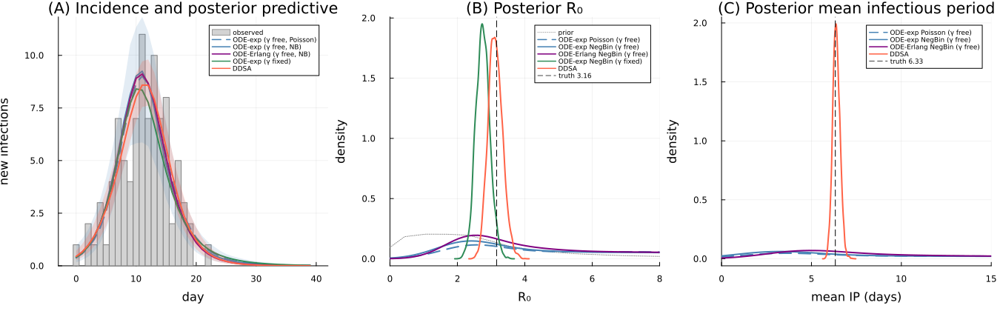

```@meta
EditURL = "ddsa_vs_ode.jl"
```

# DDSA versus ODE fits to aggregated counts

!!! note "Precomputed with the manuscript settings"
    The output on this page was precomputed using the manuscript's MCMC settings and is
    displayed without being re-evaluated. To rerun it, see [Reproducibility](../reproducibility.md).

A common way to analyse a line list is to aggregate it into a daily incidence curve and fit a
continuous-time compartmental ODE with a Poisson or negative binomial observation model (as in
the [epirecipes ODE/Turing recipe](https://github.com/epirecipes/sir-julia/blob/master/markdown/ode_turing/ode_turing.md)).
DDSA works in discrete time and uses the line list directly. This vignette fits both to one
synthetic outbreak whose infectious period (IP) is known and not exponential (Erlang with 4
stages), with five models:

| Model | Forward model | IP shape | Mean IP | Likelihood |
|:---|:---|:---|:---|:---|
| 1. ODE + Poisson | SIR ODE | exponential, assumed | ``\gamma`` inferred | Poisson daily counts |
| 2. ODE + NegBin | SIR ODE | exponential, assumed | ``\gamma`` inferred | negative binomial daily counts |
| 3. staged ODE + NegBin | SIR ODE with 4 ``I`` stages | Erlang-4, assumed | ``\gamma`` inferred | negative binomial daily counts |
| 4. ODE, ``\gamma`` fixed | SIR ODE | exponential, assumed | ``\gamma = 1/4`` fixed from "the literature" | negative binomial daily counts |
| 5. DDSA | discrete GLCT map | NegBin phase-type, shape ``r`` inferred | inferred | infection times, recovery intervals, final size |

Here ``\gamma`` is the removal rate of the ODE models (per day), ``I`` their infected compartment
and ``r`` the number of stages of the DDSA infectious period.

Both approaches are modular, so this comparison illustrates specific choices.

````julia
using DiscreteDynamicSurvivalAnalysis
using Distributions, Turing, MCMCChains, OrdinaryDiffEq, Random, Statistics, DataFrames
using Plots, StatsPlots, Measures

const FULL = get(ENV, "DDSA_FULL", "false") == "true"
t_start = time()
````

## Inputs: a synthetic Erlang-4 outbreak

The outbreak starts with one initial case in a population of ``N = 99``, so the initially
infected fraction is ``\rho = 1/N``. The transmission rate is ``\beta = 0.5`` per day, and the IP
is Erlang with 4 stages and a continuous-time mean of 4 days. The outbreak is simulated in
discrete time, with a time step of ``\Delta t = 1`` day, over 40 days. The discrete IP ``W`` has
mean ``E[W] \approx 6.33`` days, so the discrete reproduction number is ``R_0 = \beta E[W] \approx 3.16``.
The ODE models see only the daily infection counts, whereas DDSA also uses each case's recovery interval.

````julia
N, β_true, μ_ip, k, Δt, nsteps = 99, 0.5, 4.0, 4, 1.0, 40
ρ_true = 1 / N
dph_true = dph_erlang_from_mean(k, μ_ip, Δt)
EW = mean(dph_true)
R0_true = β_true * EW
data = simulate_linelist(Xoshiro(1234), dph_true, β_true, ρ_true, N, nsteps).data
incidence = data.infection_counts
K = data.final_size
(K = K, attack_rate = K / N, EW = EW, R0 = R0_true, mean_interval = mean(data.recovery_intervals))
````

````
(K = 91, attack_rate = 0.9191919191919192, EW = 6.327906827477306, R0 = 3.163953413738653, mean_interval = 6.413043478260869)
````

## Count models (ODE comparators)

Models 1–4 solve a continuous-time SIR ODE with an explicit Runge–Kutta integrator (`Tsit5`),
read the expected new infections per day from the cumulative incidence at integer days, and
attach a Poisson or negative binomial (mean ``m``, dispersion ``\phi``) count likelihood.
Non-finite solutions are rejected.

````julia
β_prior_hi = 2.5                     # β ~ Uniform(1e-4, 2.5) in all five models
γ_fix = 1 / μ_ip                      # model 4: the continuous-time mean IP (4 days) from "the literature"
NegBin2(m, ϕ) = NegativeBinomial(ϕ, clamp(ϕ / (ϕ + m), 1e-6, 1 - 1e-6))

function sir_exp_ode!(du, u, p, t)    # exponential IP (one I compartment); u = (S, I, R, C)
    S, I, R, C = u
    β, γ = p
    inf = β * I / (S + I + R) * S
    du[1] = -inf
    du[2] = inf - γ * I
    du[3] = γ * I
    du[4] = inf                       # cumulative incidence
end

function sir_erlang_ode!(du, u, p, t) # Erlang-4 IP (four I stages); u = (S, I₁…I₄, C, R)
    S = u[1]
    I = @view u[2:5]
    β, γ = p
    inf = β * sum(I) / (S + sum(I) + u[7]) * S
    kγ = k * γ
    du[1] = -inf
    du[2] = inf - kγ * I[1]
    du[3] = kγ * I[1] - kγ * I[2]
    du[4] = kγ * I[2] - kγ * I[3]
    du[5] = kγ * I[3] - kγ * I[4]
    du[6] = inf                       # cumulative incidence
    du[7] = kγ * I[4]                 # removed
end

"""Expected new infections per day from an ODE with cumulative incidence in component `c`. The
solver's warnings (unstable solutions at extreme proposals, which are then rejected) are muted."""
function daily_incidence(f!, u0, p, c, ndays)
    sol = solve(ODEProblem(f!, u0, (0.0, float(ndays)), p), Tsit5(); saveat = 1.0,
                verbose = DEVerbosity(SciMLLogging.None()))
    return clamp.(diff(Array(sol)[c, :]), 1e-6, 1e7)
end

@model function count_exp_pois(y, N)                     # model 1
    l = length(y)
    i0 ~ Uniform(1e-4, 0.2)
    β ~ Uniform(1e-4, β_prior_hi)
    γ ~ Uniform(0.02, 1.0)
    newI = daily_incidence(sir_exp_ode!, [N - i0 * N, i0 * N, 0.0, 0.0], [β, γ], 4, l)
    (length(newI) == l && all(isfinite, newI)) || (Turing.@addlogprob!(-Inf); return)
    for i in 1:l
        y[i] ~ Poisson(newI[i])
    end
end

@model function count_exp(y, N)                          # model 2
    l = length(y)
    i0 ~ Uniform(1e-4, 0.2)
    β ~ Uniform(1e-4, β_prior_hi)
    γ ~ Uniform(0.02, 1.0)
    ϕ ~ Exponential(5.0)
    newI = daily_incidence(sir_exp_ode!, [N - i0 * N, i0 * N, 0.0, 0.0], [β, γ], 4, l)
    (length(newI) == l && all(isfinite, newI)) || (Turing.@addlogprob!(-Inf); return)
    for i in 1:l
        y[i] ~ NegBin2(newI[i], ϕ)
    end
end

@model function count_erlang(y, N)                       # model 3
    l = length(y)
    i0 ~ Uniform(1e-4, 0.2)
    β ~ Uniform(1e-4, β_prior_hi)
    γ ~ Uniform(0.02, 1.0)
    ϕ ~ Exponential(5.0)
    newI = daily_incidence(sir_erlang_ode!, [N - i0 * N, i0 * N, 0.0, 0.0, 0.0, 0.0, 0.0], [β, γ], 6, l)
    (length(newI) == l && all(isfinite, newI)) || (Turing.@addlogprob!(-Inf); return)
    for i in 1:l
        y[i] ~ NegBin2(newI[i], ϕ)
    end
end

@model function count_exp_fixed(y, N, γf)                # model 4
    l = length(y)
    i0 ~ Uniform(1e-4, 0.2)
    β ~ Uniform(1e-4, β_prior_hi)
    ϕ ~ Exponential(5.0)
    newI = daily_incidence(sir_exp_ode!, [N - i0 * N, i0 * N, 0.0, 0.0], [β, γf], 4, l)
    (length(newI) == l && all(isfinite, newI)) || (Turing.@addlogprob!(-Inf); return)
    for i in 1:l
        y[i] ~ NegBin2(newI[i], ϕ)
    end
end
````

## Infection timing: Poisson counts and the DDSA multinomial term

Independent Poisson daily counts ``y_t`` with means ``\mu_t``, conditioned on their total ``K``,
are ``\text{Multinomial}(K, f)``, which is exactly the infection-time term of DDSA:

```math
\sum_t \log \text{Pois}(y_t; \mu_t) = \log \text{Multinomial}(y; K, f) + \log \text{Pois}\Big(K; \sum_t \mu_t\Big),
\qquad f_t = \mu_t \Big/ \sum_s \mu_s .
```

DDSA replaces the Poisson final-size factor with ``\text{Binomial}(N, \tau)`` for a known
population, where ``\tau`` is the map's expected fraction infected, and adds the
recovery-interval term, which aggregated counts cannot provide. The identity, on the mean
curve of the exponential ODE at the true ``\beta`` and ``\gamma = 1/4``:

````julia
μ_ode = max.(diff(Array(solve(ODEProblem(sir_exp_ode!, [N - ρ_true * N, ρ_true * N, 0.0, 0.0], (0.0, float(nsteps)),
                                         [β_true, γ_fix]), Tsit5(); saveat = 1.0))[4, :]), 1e-9)
ll_pois = sum(logpdf.(Poisson.(μ_ode), incidence))                 # Poisson counts, every day
ll_multi = infection_time_loglik(incidence, μ_ode ./ sum(μ_ode))  # DDSA's infection-time term
ll_total = logpdf(Poisson(sum(μ_ode)), K)                          # Poisson on the total
(count_poisson = ll_pois, multinomial = ll_multi, poisson_total = ll_total,
 identity_holds = isapprox(ll_pois, ll_multi + ll_total; atol = 1e-6))
````

````
(count_poisson = -67.44039284297408, multinomial = -63.105530895915805, poisson_total = -4.3348619470582435, identity_holds = true)
````

## DDSA model

The DDSA model has a NegBin IP with per-stage progression probability ``p``, propagated by the GLCT map.
The number of stages ``r`` is summed out over ``r \le \min_i \delta_i``, where ``\delta_i`` are the recovery
intervals (the shortest is 4). The population size is known, ``N = 99`` (`population = N`), so the final-size
term uses it instead of summing over an unknown ``N``.
As in the manuscript, the attack fraction ``\tau`` is clamped to ``[0.001, 0.999]`` (`NumericalGuards`).

````julia
ddsa_spec = DDSAModel(infectious_period = NegBinGLCT(1:min(10, minimum(data.recovery_intervals))),
                      priors = (β = Uniform(1e-4, β_prior_hi), ρ = Beta(1, N - 1), p = Beta(1, 1)),
                      population = N, guards = NumericalGuards(τ_bounds = (0.001, 0.999)))
````

````
DDSAModel
  infectious period: NegBinGLCT(1:4, :p)
  priors:            β ~ Distributions.Uniform{Float64}(a=0.0001, b=2.5), ρ ~ Distributions.Beta{Float64}(α=1.0, β=98.0), p ~ Distributions.Beta{Float64}(α=1.0, β=1.0)
  transmission:      β
  population:        99
  terms:             final_size, infection_times, recovery, removal_only
  guards:            τ_bounds = (0.001, 0.999), f_floor = 0.0
````

## Fit

Manuscript settings: 4 chains of 2,000 draws for every model. The count models start each chain
from a prior draw and use 2,000 adaptation steps with `max_depth = 12`, with target acceptance
0.95 for the three ``\gamma``-free models and 0.8 for the ``\gamma``-fixed one. DDSA uses the
settings of every DDSA analysis ([`default_sampler`](@ref): 1,000 adaptation steps, target
acceptance 0.8) and jittered data-based starting values.

````julia
nchains = FULL ? 4 : 2
ndraws = FULL ? 2000 : 300
nadapt = FULL ? 2000 : 300
nuts_count = NUTS(nadapt, 0.95; max_depth = 12, Δ_max = 1000.0)
nuts_fixed = NUTS(nadapt, 0.8; max_depth = 12, Δ_max = 1000.0)
nuts_ddsa = FULL ? default_sampler() : NUTS(nadapt, 0.8; max_depth = 12, Δ_max = 1000.0)

sample_count(rng, model, sampler) =
    sample(rng, model, sampler, MCMCThreads(), ndraws, nchains; progress = false, chain_type = Chains,
           initial_params = fill(InitFromPrior(), nchains))

fit_seconds = Dict{String,Float64}()
fit_seconds["ODE-exp Poisson (γ free)"] = @elapsed ch_pois = sample_count(Xoshiro(1), count_exp_pois(incidence, N), nuts_count)
fit_seconds["ODE-exp NegBin (γ free)"] = @elapsed ch_exp = sample_count(Xoshiro(2), count_exp(incidence, N), nuts_count)
fit_seconds["ODE-Erlang NegBin (γ free)"] = @elapsed ch_erl = sample_count(Xoshiro(3), count_erlang(incidence, N), nuts_count)
fit_seconds["ODE-exp NegBin (γ fixed)"] = @elapsed ch_fix = sample_count(Xoshiro(4), count_exp_fixed(incidence, N, γ_fix), nuts_fixed)
fit_seconds["DDSA"] = @elapsed ddsa_fit = fit_ddsa(Xoshiro(5), ddsa_spec, data; ndraws = ndraws, nchains = nchains,
                                                   sampler = nuts_ddsa)
ddsa_fit
````

````
DDSAFit(NegBinGLCT, 4 chains × 2000 draws, parameters: β, p, ρ, r)
````

## Results

Posterior draws of ``\beta``, the mean IP (``1/\gamma`` for the ODEs, ``r/p`` for DDSA) and
``R_0`` (``\beta/\gamma``; ``\beta \times`` mean IP for DDSA).

````julia
d = posterior_draws(ddsa_fit)
post = [
    "ODE-exp Poisson (γ free)"   => (β = vec(ch_pois[:β]), mean_ip = 1 ./ vec(ch_pois[:γ]), R0 = vec(ch_pois[:β]) ./ vec(ch_pois[:γ])),
    "ODE-exp NegBin (γ free)"    => (β = vec(ch_exp[:β]), mean_ip = 1 ./ vec(ch_exp[:γ]), R0 = vec(ch_exp[:β]) ./ vec(ch_exp[:γ])),
    "ODE-Erlang NegBin (γ free)" => (β = vec(ch_erl[:β]), mean_ip = 1 ./ vec(ch_erl[:γ]), R0 = vec(ch_erl[:β]) ./ vec(ch_erl[:γ])),
    "ODE-exp NegBin (γ fixed)"   => (β = vec(ch_fix[:β]), mean_ip = fill(μ_ip, length(ch_fix[:β])), R0 = vec(ch_fix[:β]) ./ γ_fix),
    "DDSA"                       => (β = d.β, mean_ip = d.mean_ip, R0 = d.R0),
]

ci(x; digits = 3) = "$(round(median(x); digits)) [$(round(quantile(x, 0.025); digits)), $(round(quantile(x, 0.975); digits))]"
DataFrame(model = first.(post), β = [ci(x.β) for (_, x) in post],
          mean_ip = [name == "ODE-exp NegBin (γ fixed)" ? "$μ_ip (fixed)" : ci(x.mean_ip; digits = 2) for (name, x) in post],
          R0 = [ci(x.R0; digits = 2) for (_, x) in post])
````

```@raw html
<div><div style = "float: left;"><span>5×4 DataFrame</span></div><div style = "clear: both;"></div></div><div class = "data-frame" style = "overflow-x: scroll;"><table class = "data-frame" style = "margin-bottom: 6px;"><thead><tr class = "columnLabelRow"><th class = "stubheadLabel" style = "font-weight: bold; text-align: right;">Row</th><th style = "text-align: left;">model</th><th style = "text-align: left;">β</th><th style = "text-align: left;">mean_ip</th><th style = "text-align: left;">R0</th></tr><tr class = "columnLabelRow"><th class = "stubheadLabel" style = "font-weight: bold; text-align: right;"></th><th title = "String" style = "text-align: left;">String</th><th title = "String" style = "text-align: left;">String</th><th title = "String" style = "text-align: left;">String</th><th title = "String" style = "text-align: left;">String</th></tr></thead><tbody><tr class = "dataRow"><td class = "rowLabel" style = "font-weight: bold; text-align: right;">1</td><td style = "text-align: left;">ODE-exp Poisson (γ free)</td><td style = "text-align: left;">0.485 [0.369, 0.957]</td><td style = "text-align: left;">16.1 [2.01, 47.55]</td><td style = "text-align: left;">7.62 [1.91, 20.53]</td></tr><tr class = "dataRow"><td class = "rowLabel" style = "font-weight: bold; text-align: right;">2</td><td style = "text-align: left;">ODE-exp NegBin (γ free)</td><td style = "text-align: left;">0.519 [0.373, 1.044]</td><td style = "text-align: left;">12.09 [1.74, 46.27]</td><td style = "text-align: left;">6.08 [1.77, 20.02]</td></tr><tr class = "dataRow"><td class = "rowLabel" style = "font-weight: bold; text-align: right;">3</td><td style = "text-align: left;">ODE-Erlang NegBin (γ free)</td><td style = "text-align: left;">0.438 [0.331, 0.656]</td><td style = "text-align: left;">10.98 [2.9, 44.12]</td><td style = "text-align: left;">4.59 [1.83, 17.48]</td></tr><tr class = "dataRow"><td class = "rowLabel" style = "font-weight: bold; text-align: right;">4</td><td style = "text-align: left;">ODE-exp NegBin (γ fixed)</td><td style = "text-align: left;">0.688 [0.591, 0.795]</td><td style = "text-align: left;">4.0 (fixed)</td><td style = "text-align: left;">2.75 [2.36, 3.18]</td></tr><tr class = "dataRow"><td class = "rowLabel" style = "font-weight: bold; text-align: right;">5</td><td style = "text-align: left;">DDSA</td><td style = "text-align: left;">0.489 [0.43, 0.559]</td><td style = "text-align: left;">6.38 [6.0, 6.8]</td><td style = "text-align: left;">3.12 [2.74, 3.57]</td></tr></tbody></table></div>
```

Truth: ``\beta = 0.5``, ``E[W] = 6.33`` days, ``R_0 = 3.16``. The posterior of ``r`` for DDSA:

````julia
[r => mean(d.r .== r) for r in 1:4]
````

````
4-element Vector{Pair{Int64, Float64}}:
 1 => 0.0
 2 => 0.0
 3 => 0.0
 4 => 1.0
````

Convergence: the largest ``\hat R`` and smallest bulk ESS over the sampled parameters, and the
number of divergent transitions, of each fit.

````julia
function convergence(ch, sampled = names(ch, :parameters))
    s = DataFrame(summarystats(ch[:, sampled, :]))
    return (max_rhat = round(maximum(filter(isfinite, s.rhat)); digits = 3),
            min_ess = round(Int, minimum(filter(isfinite, s.ess_bulk))),
            divergences = Int(sum(ch[:numerical_error])))
end
chains = ["ODE-exp Poisson (γ free)" => ch_pois, "ODE-exp NegBin (γ free)" => ch_exp,
          "ODE-Erlang NegBin (γ free)" => ch_erl, "ODE-exp NegBin (γ fixed)" => ch_fix]
DataFrame([[merge((model = name,), convergence(ch)) for (name, ch) in chains];
           merge((model = "DDSA",), convergence(ddsa_fit.chain, [:β, :ρ, :p]))])   # r is drawn, not sampled
````

```@raw html
<div><div style = "float: left;"><span>5×4 DataFrame</span></div><div style = "clear: both;"></div></div><div class = "data-frame" style = "overflow-x: scroll;"><table class = "data-frame" style = "margin-bottom: 6px;"><thead><tr class = "columnLabelRow"><th class = "stubheadLabel" style = "font-weight: bold; text-align: right;">Row</th><th style = "text-align: left;">model</th><th style = "text-align: left;">max_rhat</th><th style = "text-align: left;">min_ess</th><th style = "text-align: left;">divergences</th></tr><tr class = "columnLabelRow"><th class = "stubheadLabel" style = "font-weight: bold; text-align: right;"></th><th title = "String" style = "text-align: left;">String</th><th title = "Float64" style = "text-align: left;">Float64</th><th title = "Int64" style = "text-align: left;">Int64</th><th title = "Int64" style = "text-align: left;">Int64</th></tr></thead><tbody><tr class = "dataRow"><td class = "rowLabel" style = "font-weight: bold; text-align: right;">1</td><td style = "text-align: left;">ODE-exp Poisson (γ free)</td><td style = "text-align: right;">1.005</td><td style = "text-align: right;">1101</td><td style = "text-align: right;">0</td></tr><tr class = "dataRow"><td class = "rowLabel" style = "font-weight: bold; text-align: right;">2</td><td style = "text-align: left;">ODE-exp NegBin (γ free)</td><td style = "text-align: right;">1.002</td><td style = "text-align: right;">1731</td><td style = "text-align: right;">0</td></tr><tr class = "dataRow"><td class = "rowLabel" style = "font-weight: bold; text-align: right;">3</td><td style = "text-align: left;">ODE-Erlang NegBin (γ free)</td><td style = "text-align: right;">1.002</td><td style = "text-align: right;">1359</td><td style = "text-align: right;">0</td></tr><tr class = "dataRow"><td class = "rowLabel" style = "font-weight: bold; text-align: right;">4</td><td style = "text-align: left;">ODE-exp NegBin (γ fixed)</td><td style = "text-align: right;">1.002</td><td style = "text-align: right;">3367</td><td style = "text-align: right;">0</td></tr><tr class = "dataRow"><td class = "rowLabel" style = "font-weight: bold; text-align: right;">5</td><td style = "text-align: left;">DDSA</td><td style = "text-align: right;">1.001</td><td style = "text-align: right;">3366</td><td style = "text-align: right;">0</td></tr></tbody></table></div>
```

The prior on ``R_0`` implied by the uniform priors of the ``\gamma``-free count
models is very wide:

````julia
R0_prior = rand(Xoshiro(6), Uniform(1e-4, β_prior_hi), 200_000) ./ rand(Xoshiro(7), Uniform(0.02, 1.0), 200_000)
(median = median(R0_prior), q2_5 = quantile(R0_prior, 0.025), q97_5 = quantile(R0_prior, 0.975))
````

````
(median = 2.4610269396853752, q2_5 = 0.12257787475601897, q97_5 = 29.57325183030435)
````

## Plots

(A) Observed daily incidence with posterior predictive medians, and 95% bands for the
exponential NegBin ODE and DDSA (DDSA: the infection-time distribution ``f`` scaled to the
observed number of cases, `scale = :observed_total`). (B, C) Posterior densities of ``R_0`` and
the mean IP, with the prior of ``R_0`` (dotted) and the truth (dashed).

````julia
npp = FULL ? 150 : 100
function ode_predictive(rng, ch, f!, c, ncomp)
    i0s, βs = vec(ch[:i0]), vec(ch[:β])
    γs = :γ in names(ch) ? vec(ch[:γ]) : fill(γ_fix, length(βs))
    M = zeros(nsteps, npp)
    for (j, i) in enumerate(rand(rng, 1:length(βs), npp))
        u0 = zeros(ncomp)
        u0[1], u0[2] = N - i0s[i] * N, i0s[i] * N
        M[:, j] = daily_incidence(f!, u0, [βs[i], γs[i]], c, nsteps)
    end
    return M
end
bands(M) = ([quantile(M[t, :], 0.025) for t in axes(M, 1)], [median(M[t, :]) for t in axes(M, 1)],
            [quantile(M[t, :], 0.975) for t in axes(M, 1)])
days = 0:(nsteps - 1)
lp, mp, hp = bands(ode_predictive(Xoshiro(8), ch_pois, sir_exp_ode!, 4, 4))
le, me, he = bands(ode_predictive(Xoshiro(9), ch_exp, sir_exp_ode!, 4, 4))
lr, mr, hr = bands(ode_predictive(Xoshiro(10), ch_erl, sir_erlang_ode!, 6, 7))
lf, mf, hf = bands(ode_predictive(Xoshiro(11), ch_fix, sir_exp_ode!, 4, 4))
ld, md, hd = bands(posterior_predictive(Xoshiro(12), ddsa_fit; ndraws = npp, scale = :observed_total).incidence)

pA = bar(days, incidence; label = "observed", color = :lightgray, linecolor = :gray, bar_width = 1.0,
         xlabel = "day", ylabel = "new infections", title = "(A) Incidence and posterior predictive")
plot!(pA, days, mp; lw = 2, ls = :dash, color = :steelblue, label = "ODE-exp (γ free, Poisson)")
plot!(pA, days, me; ribbon = (me .- le, he .- me), fillalpha = 0.15, color = :steelblue, lw = 2, label = "ODE-exp (γ free, NB)")
plot!(pA, days, mr; lw = 2, color = :purple, label = "ODE-Erlang (γ free, NB)")
plot!(pA, days, mf; lw = 2, color = :seagreen, label = "ODE-exp (γ fixed)")
plot!(pA, days, md; ribbon = (md .- ld, hd .- md), fillalpha = 0.2, color = :tomato, lw = 2, label = "DDSA")

styles = Dict("ODE-exp Poisson (γ free)" => (color = :steelblue, ls = :dash), "ODE-exp NegBin (γ free)" => (color = :steelblue, ls = :solid),
              "ODE-Erlang NegBin (γ free)" => (color = :purple, ls = :solid), "ODE-exp NegBin (γ fixed)" => (color = :seagreen, ls = :solid),
              "DDSA" => (color = :tomato, ls = :solid))
pB = density(R0_prior; label = "prior", lw = 1, ls = :dot, color = :gray, xlims = (0, 8), xlabel = "R₀",
             ylabel = "density", title = "(B) Posterior R₀")
for (name, x) in post
    density!(pB, x.R0; label = name, lw = 2, styles[name]...)
end
vline!(pB, [R0_true]; ls = :dash, color = :black, label = "truth $(round(R0_true; digits = 2))")

pC = plot(xlims = (0, 15), xlabel = "mean IP (days)", ylabel = "density", title = "(C) Posterior mean infectious period")
for (name, x) in post
    name == "ODE-exp NegBin (γ fixed)" || density!(pC, x.mean_ip; label = name, lw = 2, styles[name]...)
end
vline!(pC, [EW]; ls = :dash, color = :black, label = "truth $(round(EW; digits = 2))")
plot(pA, pB, pC; layout = (1, 3), size = (1350, 420), legendfontsize = 6, left_margin = 5mm, bottom_margin = 8mm)
````



## Substituting your own data or model

- **Your own line list.** Replace `data` with [`linelist`](@ref)`(infection_times,
  removal_times; ...)` and `incidence` with `data.infection_counts`; the count models only need
  the daily counts and a population size.
- **Other count models.** Any ODE (or discrete-time map) and observation model can be written
  as a Turing model in the same way; only the expected daily incidence changes.
- **Other DDSA models.** Change the IP model (`GeometricIP`, `NegBinBoxcar`), make the
  population unknown (`population = K:N_max`), or drop terms the data cannot support, e.g.
  `terms = (:final_size, :infection_times)` when only an incidence curve is available (the DDSA
  analogue of the count models; see the [data-availability vignette](data_availability.md)).

```julia
counts_only = LineList(incidence; final_size = K)
spec = DDSAModel(infectious_period = NegBinGLCT(1:10; parameter = :mean_ip), transmission = :R0,
                 priors = (R0 = Uniform(0.5, 5.0), mean_ip = Uniform(1.0, 30.0), ρ = Beta(1, N - 1)),
                 population = N, terms = (:final_size, :infection_times))
fit = fit_ddsa(Xoshiro(1), spec, counts_only)
```

## Runtime

Wall time of each fit in this run (seconds, including compilation), and of the whole vignette:

````julia
DataFrame(model = first.(post), seconds = [round(fit_seconds[name]; digits = 1) for (name, _) in post],
          draws_per_chain = ndraws, chains = nchains)
````

```@raw html
<div><div style = "float: left;"><span>5×4 DataFrame</span></div><div style = "clear: both;"></div></div><div class = "data-frame" style = "overflow-x: scroll;"><table class = "data-frame" style = "margin-bottom: 6px;"><thead><tr class = "columnLabelRow"><th class = "stubheadLabel" style = "font-weight: bold; text-align: right;">Row</th><th style = "text-align: left;">model</th><th style = "text-align: left;">seconds</th><th style = "text-align: left;">draws_per_chain</th><th style = "text-align: left;">chains</th></tr><tr class = "columnLabelRow"><th class = "stubheadLabel" style = "font-weight: bold; text-align: right;"></th><th title = "String" style = "text-align: left;">String</th><th title = "Float64" style = "text-align: left;">Float64</th><th title = "Int64" style = "text-align: left;">Int64</th><th title = "Int64" style = "text-align: left;">Int64</th></tr></thead><tbody><tr class = "dataRow"><td class = "rowLabel" style = "font-weight: bold; text-align: right;">1</td><td style = "text-align: left;">ODE-exp Poisson (γ free)</td><td style = "text-align: right;">27.5</td><td style = "text-align: right;">2000</td><td style = "text-align: right;">4</td></tr><tr class = "dataRow"><td class = "rowLabel" style = "font-weight: bold; text-align: right;">2</td><td style = "text-align: left;">ODE-exp NegBin (γ free)</td><td style = "text-align: right;">36.5</td><td style = "text-align: right;">2000</td><td style = "text-align: right;">4</td></tr><tr class = "dataRow"><td class = "rowLabel" style = "font-weight: bold; text-align: right;">3</td><td style = "text-align: left;">ODE-Erlang NegBin (γ free)</td><td style = "text-align: right;">44.3</td><td style = "text-align: right;">2000</td><td style = "text-align: right;">4</td></tr><tr class = "dataRow"><td class = "rowLabel" style = "font-weight: bold; text-align: right;">4</td><td style = "text-align: left;">ODE-exp NegBin (γ fixed)</td><td style = "text-align: right;">9.7</td><td style = "text-align: right;">2000</td><td style = "text-align: right;">4</td></tr><tr class = "dataRow"><td class = "rowLabel" style = "font-weight: bold; text-align: right;">5</td><td style = "text-align: left;">DDSA</td><td style = "text-align: right;">2.1</td><td style = "text-align: right;">2000</td><td style = "text-align: right;">4</td></tr></tbody></table></div>
```

````julia
(settings = FULL ? "manuscript" : "reduced (code check, not for results)", threads = Threads.nthreads(),
 total_seconds = round(time() - t_start; digits = 1))
````

````
(settings = "manuscript", threads = 10, total_seconds = 125.3)
````

