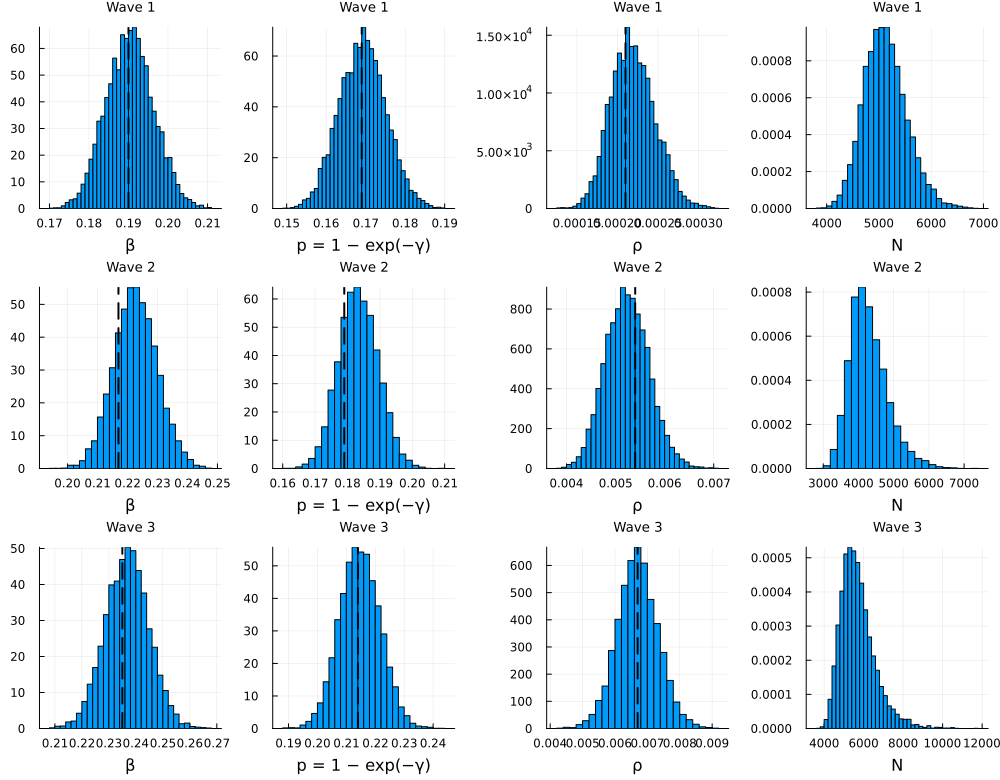
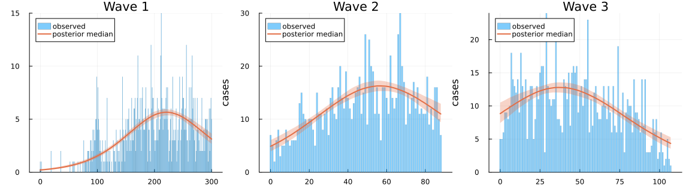
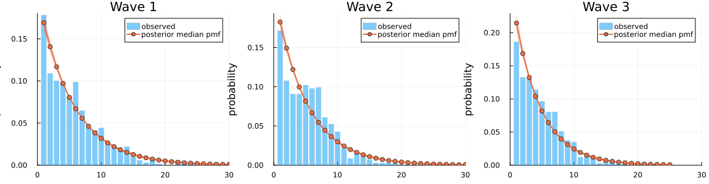

```@meta
EditURL = "ebola_drc.jl"
```

# Ebola virus disease in the DRC (2018–2020)

!!! note "Precomputed with the manuscript settings"
    The output on this page was precomputed using the manuscript's MCMC settings and is
    displayed without being re-evaluated. To rerun it, see [Reproducibility](../reproducibility.md).

This vignette fits the three waves of the 2018–2020 Ebola virus disease (EVD) epidemic in
the Democratic Republic of the Congo, as in the manuscript. The same data were analysed with
continuous-time DSA by Vossler et al. (2022), whose estimates are the point of comparison.

**The question.** For each wave, what are the transmission rate `β`, the removal rate `γ`, the
initially infected fraction `ρ` and the size `N` of the population at risk, when case records
are incomplete?

**The data and the likelihood.** Each record has a symptom-onset time, a hospitalisation time
(treated as removal), or both. Each kind of record contributes its own likelihood terms:

| Record | Terms |
|:--|:--|
| complete (onset and hospitalisation) | onset histogram (Multinomial) + recovery interval (Geometric) + final size |
| onset only | onset histogram + final size |
| hospitalisation only | convolution over the unknown onset + final size |

For a hospitalisation-only case removed on day `T`, the convolution term sums over the possible
onset days, `log Σ_{u=1}^{T−1} f_u P(W = T − u)`, where `f_u` is the map's probability of an
onset on day `u` and `W` is the infectious period. All `K` cases count in the final size
`K ~ Binomial(N, τ)`, where `τ` is the expected fraction infected over the observation window,
and `N` is summed out over a uniform prior on `K, …, K + 19,999`.

````julia
using DiscreteDynamicSurvivalAnalysis
using CSV, DataFrames, Distributions, Turing, Random, Statistics
using Plots, StatsPlots

const FULL = get(ENV, "DDSA_FULL", "false") == "true"
const WAVES = FULL ? (1, 2, 3) : (2,)
````

## Inputs

Each wave's CSV has the columns `onset` and `hosp` (days since the first case) and the flags
`event1`/`event2` marking an observed onset/hospitalisation. When a flag is 0 the corresponding
column repeats the other time, so it is set to `missing` before binning. [`linelist`](@ref) then
bins onsets by calendar day (the grid ends on the day of the last onset), takes the rounded
onset-to-hospitalisation interval of complete records, and sends hospitalisation-only records to the
convolution term.

````julia
function load_wave(w)
    df = CSV.read(example_data_path(Symbol("ebola_wave$w")), DataFrame)
    onset = ifelse.(df.event1 .== 1, df.onset, missing)
    hosp = ifelse.(df.event2 .== 1, df.hosp, missing)
    return linelist(onset, hosp)
end
waves = Dict(w => load_wave(w) for w in 1:3)

DataFrame(wave = 1:3, end_of_data = ["27 Feb 2019", "27 May 2019", "12 Sep 2019"],
          records = [waves[w].final_size for w in 1:3],
          complete = [length(waves[w].recovery_intervals) for w in 1:3],
          onset_only = [sum(waves[w].infection_counts) - length(waves[w].recovery_intervals) for w in 1:3],
          hosp_only = [length(waves[w].removal_only_steps) for w in 1:3],
          days = [waves[w].nsteps for w in 1:3])
````

```@raw html
<div><div style = "float: left;"><span>3×7 DataFrame</span></div><div style = "clear: both;"></div></div><div class = "data-frame" style = "overflow-x: scroll;"><table class = "data-frame" style = "margin-bottom: 6px;"><thead><tr class = "columnLabelRow"><th class = "stubheadLabel" style = "font-weight: bold; text-align: right;">Row</th><th style = "text-align: left;">wave</th><th style = "text-align: left;">end_of_data</th><th style = "text-align: left;">records</th><th style = "text-align: left;">complete</th><th style = "text-align: left;">onset_only</th><th style = "text-align: left;">hosp_only</th><th style = "text-align: left;">days</th></tr><tr class = "columnLabelRow"><th class = "stubheadLabel" style = "font-weight: bold; text-align: right;"></th><th title = "Int64" style = "text-align: left;">Int64</th><th title = "String" style = "text-align: left;">String</th><th title = "Int64" style = "text-align: left;">Int64</th><th title = "Int64" style = "text-align: left;">Int64</th><th title = "Int64" style = "text-align: left;">Int64</th><th title = "Int64" style = "text-align: left;">Int64</th><th title = "Int64" style = "text-align: left;">Int64</th></tr></thead><tbody><tr class = "dataRow"><td class = "rowLabel" style = "font-weight: bold; text-align: right;">1</td><td style = "text-align: right;">1</td><td style = "text-align: left;">27 Feb 2019</td><td style = "text-align: right;">907</td><td style = "text-align: right;">679</td><td style = "text-align: right;">222</td><td style = "text-align: right;">6</td><td style = "text-align: right;">301</td></tr><tr class = "dataRow"><td class = "rowLabel" style = "font-weight: bold; text-align: right;">2</td><td style = "text-align: right;">2</td><td style = "text-align: left;">27 May 2019</td><td style = "text-align: right;">1104</td><td style = "text-align: right;">706</td><td style = "text-align: right;">392</td><td style = "text-align: right;">6</td><td style = "text-align: right;">89</td></tr><tr class = "dataRow"><td class = "rowLabel" style = "font-weight: bold; text-align: right;">3</td><td style = "text-align: right;">3</td><td style = "text-align: left;">12 Sep 2019</td><td style = "text-align: right;">1069</td><td style = "text-align: right;">747</td><td style = "text-align: right;">321</td><td style = "text-align: right;">1</td><td style = "text-align: right;">108</td></tr></tbody></table></div>
```

## Model configuration

The priors are `β ~ Uniform(0.01, 1)`, `γ ~ Uniform(0.01, 1)` (per day; the
per-day removal probability is `p = 1 − exp(−γ)`) and `ρ ~ Beta(1, 500)`. The infectious
period is geometric (1-indexed), the discrete analogue of the exponential period of continuous-time
DSA. The numerical guards clamp `τ` to `[1e-6, 1 − 1e-6]` and floor `f` at `1e-10`.

````julia
ebola_spec(data) = DDSAModel(infectious_period = GeometricIP(parameter = :γ),
                             priors = (β = Uniform(0.01, 1.0), γ = Uniform(0.01, 1.0), ρ = Beta(1.0, 500.0)),
                             population = data.final_size:(data.final_size + 19_999),
                             guards = NumericalGuards(τ_bounds = (1e-6, 1 - 1e-6), f_floor = 1e-10))
````

## Fit

The manuscript ran 4 chains of 2,000 draws after 1,000 NUTS adaptation steps
([`default_sampler`](@ref)) for each wave. The chains start from jittered data-based values
([`data_based_inits`](@ref): `p` from the mean recovery interval, `β` at `R0 = 1`, `ρ` at its prior
median).

````julia
ndraws, sampler = FULL ? (2000, default_sampler()) : (1000, NUTS(500, 0.8; max_depth = 12, Δ_max = 1000.0))
fits = Dict{Int,Any}()
seconds = Dict{Int,Float64}()
for w in WAVES
    seconds[w] = @elapsed fits[w] = fit_ddsa(Xoshiro(20261006), ebola_spec(waves[w]), waves[w];
                                             ndraws = ndraws, nchains = 4, sampler = sampler)
end
fits[last(WAVES)]
````

````
DDSAFit(GeometricIP, 4 chains × 2000 draws, parameters: β, γ, ρ, N)
````

## Results

Posterior summaries of Wave 3. The derived quantities are `p`, `R0 = β / p` (the reproduction
number of the discrete-time map), the mean infectious period `mean_ip_steps = 1/p` days and the
attack rate `K_over_N = K / N`.

````julia
function summary_table(f; sigdigits = 4)
    df = DataFrame(posterior_summary(f))
    for c in names(df)[2:end]
        df[!, c] = round.(df[!, c]; sigdigits = sigdigits)
    end
    return df
end
summary_table(fits[last(WAVES)])
````

```@raw html
<div><div style = "float: left;"><span>11×8 DataFrame</span></div><div style = "clear: both;"></div></div><div class = "data-frame" style = "overflow-x: scroll;"><table class = "data-frame" style = "margin-bottom: 6px;"><thead><tr class = "columnLabelRow"><th class = "stubheadLabel" style = "font-weight: bold; text-align: right;">Row</th><th style = "text-align: left;">parameter</th><th style = "text-align: left;">mean</th><th style = "text-align: left;">std</th><th style = "text-align: left;">q2_5</th><th style = "text-align: left;">q50</th><th style = "text-align: left;">q97_5</th><th style = "text-align: left;">ess</th><th style = "text-align: left;">rhat</th></tr><tr class = "columnLabelRow"><th class = "stubheadLabel" style = "font-weight: bold; text-align: right;"></th><th title = "Symbol" style = "text-align: left;">Symbol</th><th title = "Float64" style = "text-align: left;">Float64</th><th title = "Float64" style = "text-align: left;">Float64</th><th title = "Float64" style = "text-align: left;">Float64</th><th title = "Float64" style = "text-align: left;">Float64</th><th title = "Float64" style = "text-align: left;">Float64</th><th title = "Float64" style = "text-align: left;">Float64</th><th title = "Float64" style = "text-align: left;">Float64</th></tr></thead><tbody><tr class = "dataRow"><td class = "rowLabel" style = "font-weight: bold; text-align: right;">1</td><td style = "text-align: left;">β</td><td style = "text-align: right;">0.2367</td><td style = "text-align: right;">0.008102</td><td style = "text-align: right;">0.2209</td><td style = "text-align: right;">0.2368</td><td style = "text-align: right;">0.2526</td><td style = "text-align: right;">2810.0</td><td style = "text-align: right;">1.001</td></tr><tr class = "dataRow"><td class = "rowLabel" style = "font-weight: bold; text-align: right;">2</td><td style = "text-align: left;">γ</td><td style = "text-align: right;">0.2417</td><td style = "text-align: right;">0.008916</td><td style = "text-align: right;">0.2247</td><td style = "text-align: right;">0.2415</td><td style = "text-align: right;">0.2592</td><td style = "text-align: right;">2710.0</td><td style = "text-align: right;">1.001</td></tr><tr class = "dataRow"><td class = "rowLabel" style = "font-weight: bold; text-align: right;">3</td><td style = "text-align: left;">ρ</td><td style = "text-align: right;">0.006698</td><td style = "text-align: right;">0.0006341</td><td style = "text-align: right;">0.005463</td><td style = "text-align: right;">0.00669</td><td style = "text-align: right;">0.007972</td><td style = "text-align: right;">3034.0</td><td style = "text-align: right;">1.001</td></tr><tr class = "dataRow"><td class = "rowLabel" style = "font-weight: bold; text-align: right;">4</td><td style = "text-align: left;">r</td><td style = "text-align: right;">1.0</td><td style = "text-align: right;">0.0</td><td style = "text-align: right;">1.0</td><td style = "text-align: right;">1.0</td><td style = "text-align: right;">1.0</td><td style = "text-align: right;">NaN</td><td style = "text-align: right;">NaN</td></tr><tr class = "dataRow"><td class = "rowLabel" style = "font-weight: bold; text-align: right;">5</td><td style = "text-align: left;">N</td><td style = "text-align: right;">5708.0</td><td style = "text-align: right;">879.0</td><td style = "text-align: right;">4414.0</td><td style = "text-align: right;">5571.0</td><td style = "text-align: right;">7869.0</td><td style = "text-align: right;">4070.0</td><td style = "text-align: right;">1.0</td></tr><tr class = "dataRow"><td class = "rowLabel" style = "font-weight: bold; text-align: right;">6</td><td style = "text-align: left;">K_over_N</td><td style = "text-align: right;">0.1913</td><td style = "text-align: right;">0.02692</td><td style = "text-align: right;">0.1358</td><td style = "text-align: right;">0.1919</td><td style = "text-align: right;">0.2422</td><td style = "text-align: right;">4070.0</td><td style = "text-align: right;">1.0</td></tr><tr class = "dataRow"><td class = "rowLabel" style = "font-weight: bold; text-align: right;">7</td><td style = "text-align: left;">τ</td><td style = "text-align: right;">0.1913</td><td style = "text-align: right;">0.02635</td><td style = "text-align: right;">0.1362</td><td style = "text-align: right;">0.1919</td><td style = "text-align: right;">0.2401</td><td style = "text-align: right;">3963.0</td><td style = "text-align: right;">1.0</td></tr><tr class = "dataRow"><td class = "rowLabel" style = "font-weight: bold; text-align: right;">8</td><td style = "text-align: left;">p</td><td style = "text-align: right;">0.2147</td><td style = "text-align: right;">0.007</td><td style = "text-align: right;">0.2012</td><td style = "text-align: right;">0.2146</td><td style = "text-align: right;">0.2283</td><td style = "text-align: right;">2710.0</td><td style = "text-align: right;">1.001</td></tr><tr class = "dataRow"><td class = "rowLabel" style = "font-weight: bold; text-align: right;">9</td><td style = "text-align: left;">mean_ip</td><td style = "text-align: right;">4.663</td><td style = "text-align: right;">0.1523</td><td style = "text-align: right;">4.38</td><td style = "text-align: right;">4.661</td><td style = "text-align: right;">4.969</td><td style = "text-align: right;">2710.0</td><td style = "text-align: right;">1.001</td></tr><tr class = "dataRow"><td class = "rowLabel" style = "font-weight: bold; text-align: right;">10</td><td style = "text-align: left;">mean_ip_steps</td><td style = "text-align: right;">4.663</td><td style = "text-align: right;">0.1523</td><td style = "text-align: right;">4.38</td><td style = "text-align: right;">4.661</td><td style = "text-align: right;">4.969</td><td style = "text-align: right;">2710.0</td><td style = "text-align: right;">1.001</td></tr><tr class = "dataRow"><td class = "rowLabel" style = "font-weight: bold; text-align: right;">11</td><td style = "text-align: left;">R0</td><td style = "text-align: right;">1.103</td><td style = "text-align: right;">0.0198</td><td style = "text-align: right;">1.063</td><td style = "text-align: right;">1.103</td><td style = "text-align: right;">1.141</td><td style = "text-align: right;">4321.0</td><td style = "text-align: right;">1.001</td></tr></tbody></table></div>
```

The implied number of initial infectives `I0 = ρ N` (posterior median and 95% interval) for each
fitted wave:

````julia
i0(w) = (d = posterior_draws(fits[w]); quantile(d.ρ .* d.N, [0.5, 0.025, 0.975]))
DataFrame(wave = collect(WAVES), I0_median = [round(i0(w)[1]; digits = 2) for w in WAVES],
          I0_lower = [round(i0(w)[2]; digits = 2) for w in WAVES], I0_upper = [round(i0(w)[3]; digits = 2) for w in WAVES])
````

```@raw html
<div><div style = "float: left;"><span>3×4 DataFrame</span></div><div style = "clear: both;"></div></div><div class = "data-frame" style = "overflow-x: scroll;"><table class = "data-frame" style = "margin-bottom: 6px;"><thead><tr class = "columnLabelRow"><th class = "stubheadLabel" style = "font-weight: bold; text-align: right;">Row</th><th style = "text-align: left;">wave</th><th style = "text-align: left;">I0_median</th><th style = "text-align: left;">I0_lower</th><th style = "text-align: left;">I0_upper</th></tr><tr class = "columnLabelRow"><th class = "stubheadLabel" style = "font-weight: bold; text-align: right;"></th><th title = "Int64" style = "text-align: left;">Int64</th><th title = "Float64" style = "text-align: left;">Float64</th><th title = "Float64" style = "text-align: left;">Float64</th><th title = "Float64" style = "text-align: left;">Float64</th></tr></thead><tbody><tr class = "dataRow"><td class = "rowLabel" style = "font-weight: bold; text-align: right;">1</td><td style = "text-align: right;">1</td><td style = "text-align: right;">1.12</td><td style = "text-align: right;">0.79</td><td style = "text-align: right;">1.54</td></tr><tr class = "dataRow"><td class = "rowLabel" style = "font-weight: bold; text-align: right;">2</td><td style = "text-align: right;">2</td><td style = "text-align: right;">22.24</td><td style = "text-align: right;">17.47</td><td style = "text-align: right;">28.6</td></tr><tr class = "dataRow"><td class = "rowLabel" style = "font-weight: bold; text-align: right;">3</td><td style = "text-align: right;">3</td><td style = "text-align: right;">37.58</td><td style = "text-align: right;">30.34</td><td style = "text-align: right;">46.76</td></tr></tbody></table></div>
```

**Comparison with Vossler et al. (2022).** Their continuous-time removal rate `γ` is compared with
DDSA's `p`, their `β/γ` with `R0` and their `1/γ` with the mean infectious period.

````julia
const VOSSLER = Dict(1 => (β = 0.190, γ = 0.169, ρ = 0.00021, R0 = 1.124, ip = 5.9),
                     2 => (β = 0.217, γ = 0.179, ρ = 0.0054, R0 = 1.214, ip = 5.6),
                     3 => (β = 0.235, γ = 0.214, ρ = 0.0067, R0 = 1.098, ip = 4.7))
fmt(x) = (q = quantile(x, [0.5, 0.025, 0.975]); "$(round(q[1]; sigdigits = 3)) [$(round(q[2]; sigdigits = 3)), $(round(q[3]; sigdigits = 3))]")
rows = map(Iterators.product((:β, :p, :ρ, :R0, :mean_ip_steps), WAVES)) do (q, w)
    d = posterior_draws(fits[w])
    v = VOSSLER[w]
    ref = q === :β ? v.β : q === :p ? v.γ : q === :ρ ? v.ρ : q === :R0 ? v.R0 : v.ip
    (wave = w, DDSA = string(q), median_95 = fmt(getproperty(d, q)),
     Vossler_quantity = q === :p ? "γ" : q === :R0 ? "β/γ" : q === :mean_ip_steps ? "1/γ" : string(q),
     Vossler_2022 = ref)
end
DataFrame(vec(rows))
````

```@raw html
<div><div style = "float: left;"><span>15×5 DataFrame</span></div><div style = "clear: both;"></div></div><div class = "data-frame" style = "overflow-x: scroll;"><table class = "data-frame" style = "margin-bottom: 6px;"><thead><tr class = "columnLabelRow"><th class = "stubheadLabel" style = "font-weight: bold; text-align: right;">Row</th><th style = "text-align: left;">wave</th><th style = "text-align: left;">DDSA</th><th style = "text-align: left;">median_95</th><th style = "text-align: left;">Vossler_quantity</th><th style = "text-align: left;">Vossler_2022</th></tr><tr class = "columnLabelRow"><th class = "stubheadLabel" style = "font-weight: bold; text-align: right;"></th><th title = "Int64" style = "text-align: left;">Int64</th><th title = "String" style = "text-align: left;">String</th><th title = "String" style = "text-align: left;">String</th><th title = "String" style = "text-align: left;">String</th><th title = "Float64" style = "text-align: left;">Float64</th></tr></thead><tbody><tr class = "dataRow"><td class = "rowLabel" style = "font-weight: bold; text-align: right;">1</td><td style = "text-align: right;">1</td><td style = "text-align: left;">β</td><td style = "text-align: left;">0.19 [0.179, 0.202]</td><td style = "text-align: left;">β</td><td style = "text-align: right;">0.19</td></tr><tr class = "dataRow"><td class = "rowLabel" style = "font-weight: bold; text-align: right;">2</td><td style = "text-align: right;">1</td><td style = "text-align: left;">p</td><td style = "text-align: left;">0.169 [0.158, 0.181]</td><td style = "text-align: left;">γ</td><td style = "text-align: right;">0.169</td></tr><tr class = "dataRow"><td class = "rowLabel" style = "font-weight: bold; text-align: right;">3</td><td style = "text-align: right;">1</td><td style = "text-align: left;">ρ</td><td style = "text-align: left;">0.000218 [0.00017, 0.000275]</td><td style = "text-align: left;">ρ</td><td style = "text-align: right;">0.00021</td></tr><tr class = "dataRow"><td class = "rowLabel" style = "font-weight: bold; text-align: right;">4</td><td style = "text-align: right;">1</td><td style = "text-align: left;">R0</td><td style = "text-align: left;">1.12 [1.11, 1.14]</td><td style = "text-align: left;">β/γ</td><td style = "text-align: right;">1.124</td></tr><tr class = "dataRow"><td class = "rowLabel" style = "font-weight: bold; text-align: right;">5</td><td style = "text-align: right;">1</td><td style = "text-align: left;">mean_ip_steps</td><td style = "text-align: left;">5.91 [5.53, 6.33]</td><td style = "text-align: left;">1/γ</td><td style = "text-align: right;">5.9</td></tr><tr class = "dataRow"><td class = "rowLabel" style = "font-weight: bold; text-align: right;">6</td><td style = "text-align: right;">2</td><td style = "text-align: left;">β</td><td style = "text-align: left;">0.223 [0.209, 0.237]</td><td style = "text-align: left;">β</td><td style = "text-align: right;">0.217</td></tr><tr class = "dataRow"><td class = "rowLabel" style = "font-weight: bold; text-align: right;">7</td><td style = "text-align: right;">2</td><td style = "text-align: left;">p</td><td style = "text-align: left;">0.183 [0.172, 0.195]</td><td style = "text-align: left;">γ</td><td style = "text-align: right;">0.179</td></tr><tr class = "dataRow"><td class = "rowLabel" style = "font-weight: bold; text-align: right;">8</td><td style = "text-align: right;">2</td><td style = "text-align: left;">ρ</td><td style = "text-align: left;">0.00523 [0.00442, 0.00614]</td><td style = "text-align: left;">ρ</td><td style = "text-align: right;">0.0054</td></tr><tr class = "dataRow"><td class = "rowLabel" style = "font-weight: bold; text-align: right;">9</td><td style = "text-align: right;">2</td><td style = "text-align: left;">R0</td><td style = "text-align: left;">1.21 [1.17, 1.26]</td><td style = "text-align: left;">β/γ</td><td style = "text-align: right;">1.214</td></tr><tr class = "dataRow"><td class = "rowLabel" style = "font-weight: bold; text-align: right;">10</td><td style = "text-align: right;">2</td><td style = "text-align: left;">mean_ip_steps</td><td style = "text-align: left;">5.46 [5.12, 5.82]</td><td style = "text-align: left;">1/γ</td><td style = "text-align: right;">5.6</td></tr><tr class = "dataRow"><td class = "rowLabel" style = "font-weight: bold; text-align: right;">11</td><td style = "text-align: right;">3</td><td style = "text-align: left;">β</td><td style = "text-align: left;">0.237 [0.221, 0.253]</td><td style = "text-align: left;">β</td><td style = "text-align: right;">0.235</td></tr><tr class = "dataRow"><td class = "rowLabel" style = "font-weight: bold; text-align: right;">12</td><td style = "text-align: right;">3</td><td style = "text-align: left;">p</td><td style = "text-align: left;">0.215 [0.201, 0.228]</td><td style = "text-align: left;">γ</td><td style = "text-align: right;">0.214</td></tr><tr class = "dataRow"><td class = "rowLabel" style = "font-weight: bold; text-align: right;">13</td><td style = "text-align: right;">3</td><td style = "text-align: left;">ρ</td><td style = "text-align: left;">0.00669 [0.00546, 0.00797]</td><td style = "text-align: left;">ρ</td><td style = "text-align: right;">0.0067</td></tr><tr class = "dataRow"><td class = "rowLabel" style = "font-weight: bold; text-align: right;">14</td><td style = "text-align: right;">3</td><td style = "text-align: left;">R0</td><td style = "text-align: left;">1.1 [1.06, 1.14]</td><td style = "text-align: left;">β/γ</td><td style = "text-align: right;">1.098</td></tr><tr class = "dataRow"><td class = "rowLabel" style = "font-weight: bold; text-align: right;">15</td><td style = "text-align: right;">3</td><td style = "text-align: left;">mean_ip_steps</td><td style = "text-align: left;">4.66 [4.38, 4.97]</td><td style = "text-align: left;">1/γ</td><td style = "text-align: right;">4.7</td></tr></tbody></table></div>
```

The manuscript's estimates were close to Vossler et al. for every wave, e.g. Wave 2:
`β = 0.222` (0.208–0.236), `γ = 0.202` (0.188–0.217), i.e. `p = 0.183` (0.171–0.195), and
`R0 = 1.215` (1.169–1.261).

Posterior densities, with Vossler et al.'s estimates (dashed):

````julia
panels = Any[]
for w in WAVES
    d = posterior_draws(fits[w])
    v = VOSSLER[w]
    for (x, ref, lab) in ((d.β, v.β, "β"), (d.p, v.γ, "p = 1 − exp(−γ)"), (d.ρ, v.ρ, "ρ"), (d.N, nothing, "N"))
        p = histogram(x; normalize = :pdf, bins = 40, label = "", xlabel = lab, title = "Wave $w", titlefontsize = 9)
        ref === nothing || vline!(p, [ref]; label = "", color = :black, linestyle = :dash, linewidth = 2)
        push!(panels, p)
    end
end
plot(panels...; layout = (length(WAVES), 4), size = (1000, 260 * length(WAVES)))
````



## Posterior predictive checks

`f` at the posterior draws, scaled to the number of cases with a known onset
(scale `:observed_total`), against the onset histogram: the manuscript's epidemic-curve figure
(one panel per wave).

````julia
ppc_plots = map(WAVES) do w
    pp = posterior_predictive(Xoshiro(1234 + w), fits[w]; ndraws = 500, scale = :observed_total)
    plot(pp; title = "Wave $w", xlabel = "days since first case", ylabel = "cases", legend = :topleft)
end
plot(ppc_plots...; layout = (1, length(WAVES)), size = (350 * length(WAVES) + 100, 320))
````



The fitted geometric infectious period against the recorded onset-to-hospitalisation intervals of
the complete records:

````julia
rp_plots = [plot(recovery_predictive(fits[w]; ndraws = 500); title = "Wave $w", xlims = (0, 30)) for w in WAVES]
plot(rp_plots...; layout = (1, length(WAVES)), size = (350 * length(WAVES) + 100, 300))
````



## Substituting your own data or model

- **Data.** Pass onset and removal times to [`linelist`](@ref), with `missing` for the unobserved
  ones: complete records give recovery intervals, onset-only records enter the onset histogram, and
  removal-only records enter the convolution term (`:removal_only`). Records with both times missing
  are rejected, so drop them (or count them in the final size by building the [`LineList`](@ref)
  directly with a larger `final_size`).
- **Population.** `population = K:(K + 19_999)` puts a uniform prior on `N`. Use an integer for a
  known population, or an [`NGrid`](@ref) for another prior.
- **Infectious period.** `GeometricIP(parameter = :γ)` matches continuous-time DSA. For a more
  peaked period use `NegBinGLCT(1:10)` (with a prior on `p` or `mean_ip`); its number of stages is
  summed out.
- **Likelihood terms.** `terms = (:final_size, :infection_times, :recovery)` drops the convolution
  term, e.g. to check how much the hospitalisation-only records matter.

## Runtime

````julia
DataFrame(wave = collect(WAVES), sampling_seconds = [round(seconds[w]; digits = 1) for w in WAVES])
````

```@raw html
<div><div style = "float: left;"><span>3×2 DataFrame</span></div><div style = "clear: both;"></div></div><div class = "data-frame" style = "overflow-x: scroll;"><table class = "data-frame" style = "margin-bottom: 6px;"><thead><tr class = "columnLabelRow"><th class = "stubheadLabel" style = "font-weight: bold; text-align: right;">Row</th><th style = "text-align: left;">wave</th><th style = "text-align: left;">sampling_seconds</th></tr><tr class = "columnLabelRow"><th class = "stubheadLabel" style = "font-weight: bold; text-align: right;"></th><th title = "Int64" style = "text-align: left;">Int64</th><th title = "Float64" style = "text-align: left;">Float64</th></tr></thead><tbody><tr class = "dataRow"><td class = "rowLabel" style = "font-weight: bold; text-align: right;">1</td><td style = "text-align: right;">1</td><td style = "text-align: right;">28.3</td></tr><tr class = "dataRow"><td class = "rowLabel" style = "font-weight: bold; text-align: right;">2</td><td style = "text-align: right;">2</td><td style = "text-align: right;">8.0</td></tr><tr class = "dataRow"><td class = "rowLabel" style = "font-weight: bold; text-align: right;">3</td><td style = "text-align: right;">3</td><td style = "text-align: right;">9.6</td></tr></tbody></table></div>
```

````julia
(settings = FULL ? "manuscript (4 chains × 2,000 draws, 1,000 adaptation steps; waves 1–3)" :
                   "reduced (4 chains × 1,000 draws, 500 adaptation steps; wave 2; code check, not for results)",
 threads = Threads.nthreads(), total_seconds = round(time() - T_START; digits = 1))
````

````
(settings = "manuscript (4 chains × 2,000 draws, 1,000 adaptation steps; waves 1–3)", threads = 10, total_seconds = 47.4)
````

