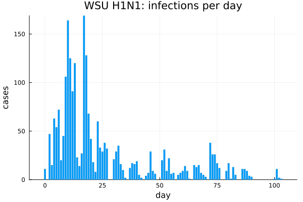
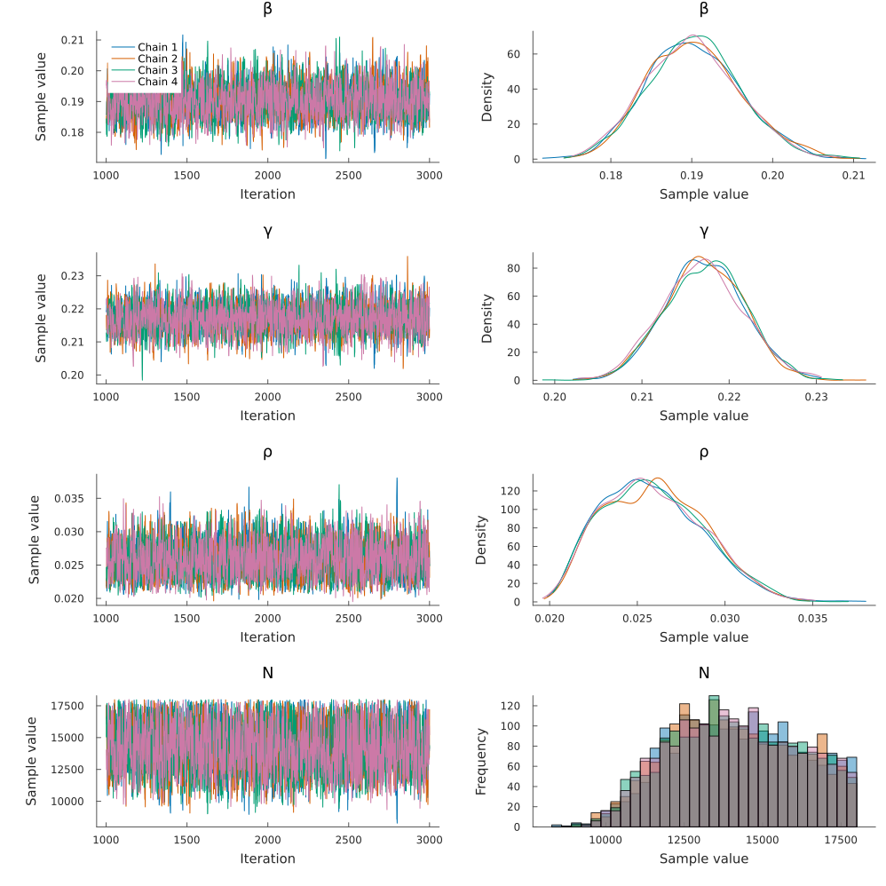
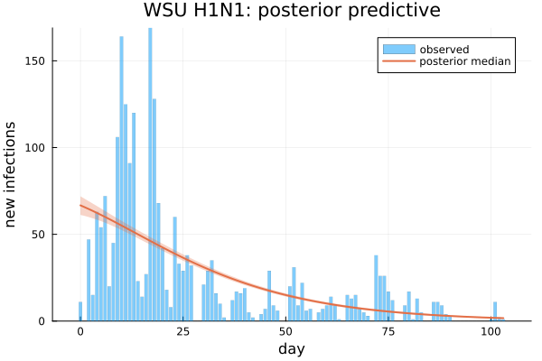
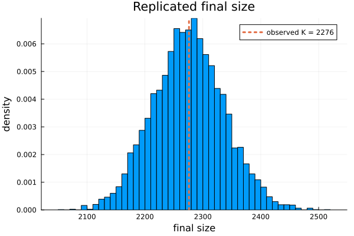
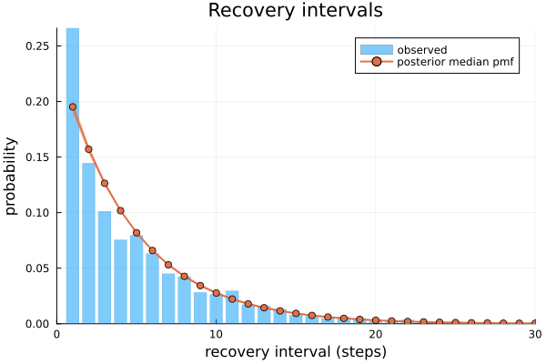
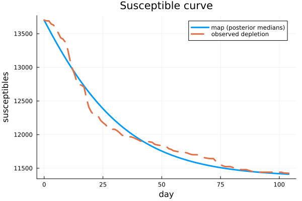
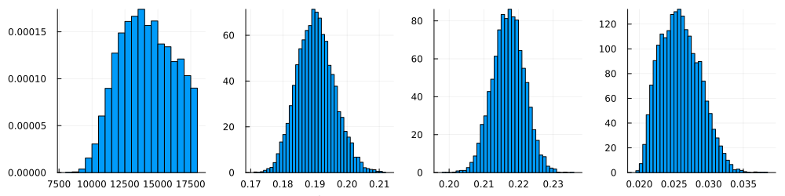

```@meta
EditURL = "h1n1_wsu.jl"
```

# H1N1 influenza at Washington State University (2009)

!!! note "Precomputed with the manuscript settings"
    The output on this page was precomputed using the manuscript's MCMC settings and is
    displayed without being re-evaluated. To rerun it, see [Reproducibility](../reproducibility.md).

This vignette fits the 2009 H1N1 influenza outbreak at Washington State University (WSU).
The same data were analysed with continuous-time DSA by KhudaBukhsh et al. (2020), who introduced
the concept of Survival Dynamical Systems (SDS), and whose estimates are the point of comparison.

**The question.** Given the infection times and recovery intervals of several cases in a closed
population, what are the transmission rate `β`, the removal rate `γ`, the initially infected fraction
`ρ`, and the size `N` of the population at risk? `N` is not known, but the campus about 18,000 students.

**The model.** A discrete-time SIR map with a geometric infectious period on a daily grid, with
- the final size `K ~ Binomial(N, τ)`, where `τ` is the expected fraction infected over the
  observation window;
- the infection-day histogram `~ Multinomial(K, f)`, where `f` is the distribution of infection
  days given by the map;
- geometric recovery intervals, right-censored for the 13 cases still infectious at day 104.

````julia
using DiscreteDynamicSurvivalAnalysis
using CSV, DataFrames, Distributions, Turing, Random, Statistics
using Plots, StatsPlots

const FULL = get(ENV, "DDSA_FULL", "false") == "true"
````

## Inputs

`WSU.csv` comes from KhudaBukhsh et al. (SDS.Epidemic repository): column `V1` holds the infection
times and `V2` the recovery times, in days. The raw data were daily case counts, but KhudaBukhsh et al.
spread the infection times within each day and *simulated* the recovery times from an exponential
distribution with rate `1/5.5` per day, so the recovery intervals are synthetic (see `data/README.md`).

The observation window is days 0–103: with `nsteps = 104` the infections of day `d` fall in step
`d + 1`, and recoveries at or after day 104 are right-censored there.

````julia
df = CSV.read(example_data_path(:wsu), DataFrame)
data = linelist(df.V1, df.V2; nsteps = 104, censor_at = 104.0)
````

````
LineList(nsteps = 104, Δt = 1.0, final_size = 2276, known infection times = 2276, recovery intervals = 2276 (13 censored))
````

````julia
bar(0:(data.nsteps - 1), data.infection_counts; label = "", xlabel = "day", ylabel = "cases",
    title = "WSU H1N1: infections per day", linewidth = 0)
````



## Model configuration

The priors are `β ~ Uniform(0.01, 5)`, `γ ~ LogNormal(log(1/5.5), 0.3)` truncated to
`[0.01, 1]` (centred on the rate used to simulate the recovery times), and `ρ ~ Beta(1, 10)`. `γ` is
a rate per day: the per-day removal probability is `p = 1 − exp(−γ)`. `N` has a discrete uniform
prior on `(K + 1):18000`, which is summed out of the likelihood.
The infection-time distribution is floored at `1e-10` before the multinomial term.

````julia
K = data.final_size
spec = DDSAModel(infectious_period = GeometricIP(parameter = :γ),
                 priors = (β = Uniform(0.01, 5.0), γ = truncated(LogNormal(log(1 / 5.5), 0.3), 0.01, 1.0),
                           ρ = Beta(1.0, 10.0)),
                 population = (K + 1):18_000,
                 guards = NumericalGuards(f_floor = 1e-10))
````

## Fit

The manuscript ran 4 chains of 2,000 draws after 1,000 NUTS adaptation steps
([`default_sampler`](@ref)). The chains start from jittered data-based values ([`data_based_inits`](@ref)).
After sampling, `N` is drawn once per draw from its exact conditional posterior and added to the
chain.

````julia
ndraws, sampler = FULL ? (2000, default_sampler()) : (1000, NUTS(500, 0.8; max_depth = 12, Δ_max = 1000.0))
t_fit = @elapsed wsu_fit = fit_ddsa(Xoshiro(20261006), spec, data; ndraws = ndraws, nchains = 4, sampler = sampler)
wsu_fit
````

````
DDSAFit(GeometricIP, 4 chains × 2000 draws, parameters: β, γ, ρ, N)
````

## Results

Posterior summaries, with the derived quantities: `R0 = β / p` (the reproduction number of the
discrete-time map), the mean infectious period `mean_ip_steps = 1/p` days, and the attack rate
`K_over_N = K / N`.

````julia
function summary_table(f; sigdigits = 4)
    df = DataFrame(posterior_summary(f))
    for c in names(df)[2:end]
        df[!, c] = round.(df[!, c]; sigdigits = sigdigits)
    end
    return df
end
summary_table(wsu_fit)
````

```@raw html
<div><div style = "float: left;"><span>11×8 DataFrame</span></div><div style = "clear: both;"></div></div><div class = "data-frame" style = "overflow-x: scroll;"><table class = "data-frame" style = "margin-bottom: 6px;"><thead><tr class = "columnLabelRow"><th class = "stubheadLabel" style = "font-weight: bold; text-align: right;">Row</th><th style = "text-align: left;">parameter</th><th style = "text-align: left;">mean</th><th style = "text-align: left;">std</th><th style = "text-align: left;">q2_5</th><th style = "text-align: left;">q50</th><th style = "text-align: left;">q97_5</th><th style = "text-align: left;">ess</th><th style = "text-align: left;">rhat</th></tr><tr class = "columnLabelRow"><th class = "stubheadLabel" style = "font-weight: bold; text-align: right;"></th><th title = "Symbol" style = "text-align: left;">Symbol</th><th title = "Float64" style = "text-align: left;">Float64</th><th title = "Float64" style = "text-align: left;">Float64</th><th title = "Float64" style = "text-align: left;">Float64</th><th title = "Float64" style = "text-align: left;">Float64</th><th title = "Float64" style = "text-align: left;">Float64</th><th title = "Float64" style = "text-align: left;">Float64</th><th title = "Float64" style = "text-align: left;">Float64</th></tr></thead><tbody><tr class = "dataRow"><td class = "rowLabel" style = "font-weight: bold; text-align: right;">1</td><td style = "text-align: left;">β</td><td style = "text-align: right;">0.1903</td><td style = "text-align: right;">0.005773</td><td style = "text-align: right;">0.1795</td><td style = "text-align: right;">0.1901</td><td style = "text-align: right;">0.2021</td><td style = "text-align: right;">2971.0</td><td style = "text-align: right;">1.001</td></tr><tr class = "dataRow"><td class = "rowLabel" style = "font-weight: bold; text-align: right;">2</td><td style = "text-align: left;">γ</td><td style = "text-align: right;">0.2172</td><td style = "text-align: right;">0.004576</td><td style = "text-align: right;">0.2084</td><td style = "text-align: right;">0.2172</td><td style = "text-align: right;">0.2261</td><td style = "text-align: right;">3350.0</td><td style = "text-align: right;">1.001</td></tr><tr class = "dataRow"><td class = "rowLabel" style = "font-weight: bold; text-align: right;">3</td><td style = "text-align: left;">ρ</td><td style = "text-align: right;">0.02592</td><td style = "text-align: right;">0.00284</td><td style = "text-align: right;">0.02124</td><td style = "text-align: right;">0.02575</td><td style = "text-align: right;">0.03177</td><td style = "text-align: right;">3157.0</td><td style = "text-align: right;">1.001</td></tr><tr class = "dataRow"><td class = "rowLabel" style = "font-weight: bold; text-align: right;">4</td><td style = "text-align: left;">r</td><td style = "text-align: right;">1.0</td><td style = "text-align: right;">0.0</td><td style = "text-align: right;">1.0</td><td style = "text-align: right;">1.0</td><td style = "text-align: right;">1.0</td><td style = "text-align: right;">NaN</td><td style = "text-align: right;">NaN</td></tr><tr class = "dataRow"><td class = "rowLabel" style = "font-weight: bold; text-align: right;">5</td><td style = "text-align: left;">N</td><td style = "text-align: right;">14140.0</td><td style = "text-align: right;">2017.0</td><td style = "text-align: right;">10490.0</td><td style = "text-align: right;">14060.0</td><td style = "text-align: right;">17710.0</td><td style = "text-align: right;">3157.0</td><td style = "text-align: right;">1.001</td></tr><tr class = "dataRow"><td class = "rowLabel" style = "font-weight: bold; text-align: right;">6</td><td style = "text-align: left;">K_over_N</td><td style = "text-align: right;">0.1644</td><td style = "text-align: right;">0.02437</td><td style = "text-align: right;">0.1285</td><td style = "text-align: right;">0.1618</td><td style = "text-align: right;">0.2169</td><td style = "text-align: right;">3157.0</td><td style = "text-align: right;">1.001</td></tr><tr class = "dataRow"><td class = "rowLabel" style = "font-weight: bold; text-align: right;">7</td><td style = "text-align: left;">τ</td><td style = "text-align: right;">0.1643</td><td style = "text-align: right;">0.02429</td><td style = "text-align: right;">0.1282</td><td style = "text-align: right;">0.1616</td><td style = "text-align: right;">0.2168</td><td style = "text-align: right;">3096.0</td><td style = "text-align: right;">1.001</td></tr><tr class = "dataRow"><td class = "rowLabel" style = "font-weight: bold; text-align: right;">8</td><td style = "text-align: left;">p</td><td style = "text-align: right;">0.1952</td><td style = "text-align: right;">0.003683</td><td style = "text-align: right;">0.1881</td><td style = "text-align: right;">0.1952</td><td style = "text-align: right;">0.2023</td><td style = "text-align: right;">3350.0</td><td style = "text-align: right;">1.001</td></tr><tr class = "dataRow"><td class = "rowLabel" style = "font-weight: bold; text-align: right;">9</td><td style = "text-align: left;">mean_ip</td><td style = "text-align: right;">5.125</td><td style = "text-align: right;">0.09683</td><td style = "text-align: right;">4.942</td><td style = "text-align: right;">5.122</td><td style = "text-align: right;">5.315</td><td style = "text-align: right;">3350.0</td><td style = "text-align: right;">1.001</td></tr><tr class = "dataRow"><td class = "rowLabel" style = "font-weight: bold; text-align: right;">10</td><td style = "text-align: left;">mean_ip_steps</td><td style = "text-align: right;">5.125</td><td style = "text-align: right;">0.09683</td><td style = "text-align: right;">4.942</td><td style = "text-align: right;">5.122</td><td style = "text-align: right;">5.315</td><td style = "text-align: right;">3350.0</td><td style = "text-align: right;">1.001</td></tr><tr class = "dataRow"><td class = "rowLabel" style = "font-weight: bold; text-align: right;">11</td><td style = "text-align: left;">R0</td><td style = "text-align: right;">0.9748</td><td style = "text-align: right;">0.02335</td><td style = "text-align: right;">0.9388</td><td style = "text-align: right;">0.9721</td><td style = "text-align: right;">1.026</td><td style = "text-align: right;">3147.0</td><td style = "text-align: right;">1.001</td></tr></tbody></table></div>
```

The convergence diagnostics are in the `ess` and `rhat` columns; trace plots of the sampled
parameters and `N`:

````julia
plot(wsu_fit.chain[[:β, :γ, :ρ, :N]])
````



**Comparison with KhudaBukhsh et al. (2020).** Their SDS analysis fixed `1/γ = 5.5` days and imputed
`N` from the final-size relation. They report `N = 7,051` (90% interval 6,602–7,581), `β = 0.189`
and `R0 = 1.06`. The 90% intervals here:

````julia
d = posterior_draws(wsu_fit)
DataFrame(quantity = ["N", "β", "γ", "ρ", "R0", "mean_ip_steps"],
          median = [median(x) for x in (d.N, d.β, d.γ, d.ρ, d.R0, d.mean_ip_steps)],
          q5 = [quantile(x, 0.05) for x in (d.N, d.β, d.γ, d.ρ, d.R0, d.mean_ip_steps)],
          q95 = [quantile(x, 0.95) for x in (d.N, d.β, d.γ, d.ρ, d.R0, d.mean_ip_steps)],
          KhudaBukhsh_2020 = ["7051 [6602, 7581]", "0.189", "1/5.5 (fixed)", "", "1.06", "5.5 (fixed)"])
````

```@raw html
<div><div style = "float: left;"><span>6×5 DataFrame</span></div><div style = "clear: both;"></div></div><div class = "data-frame" style = "overflow-x: scroll;"><table class = "data-frame" style = "margin-bottom: 6px;"><thead><tr class = "columnLabelRow"><th class = "stubheadLabel" style = "font-weight: bold; text-align: right;">Row</th><th style = "text-align: left;">quantity</th><th style = "text-align: left;">median</th><th style = "text-align: left;">q5</th><th style = "text-align: left;">q95</th><th style = "text-align: left;">KhudaBukhsh_2020</th></tr><tr class = "columnLabelRow"><th class = "stubheadLabel" style = "font-weight: bold; text-align: right;"></th><th title = "String" style = "text-align: left;">String</th><th title = "Float64" style = "text-align: left;">Float64</th><th title = "Float64" style = "text-align: left;">Float64</th><th title = "Float64" style = "text-align: left;">Float64</th><th title = "String" style = "text-align: left;">String</th></tr></thead><tbody><tr class = "dataRow"><td class = "rowLabel" style = "font-weight: bold; text-align: right;">1</td><td style = "text-align: left;">N</td><td style = "text-align: right;">14064.5</td><td style = "text-align: right;">10905.0</td><td style = "text-align: right;">17452.1</td><td style = "text-align: left;">7051 [6602, 7581]</td></tr><tr class = "dataRow"><td class = "rowLabel" style = "font-weight: bold; text-align: right;">2</td><td style = "text-align: left;">β</td><td style = "text-align: right;">0.190096</td><td style = "text-align: right;">0.181042</td><td style = "text-align: right;">0.200255</td><td style = "text-align: left;">0.189</td></tr><tr class = "dataRow"><td class = "rowLabel" style = "font-weight: bold; text-align: right;">3</td><td style = "text-align: left;">γ</td><td style = "text-align: right;">0.217184</td><td style = "text-align: right;">0.209591</td><td style = "text-align: right;">0.224596</td><td style = "text-align: left;">1/5.5 (fixed)</td></tr><tr class = "dataRow"><td class = "rowLabel" style = "font-weight: bold; text-align: right;">4</td><td style = "text-align: left;">ρ</td><td style = "text-align: right;">0.025754</td><td style = "text-align: right;">0.021668</td><td style = "text-align: right;">0.0308612</td><td style = "text-align: left;"></td></tr><tr class = "dataRow"><td class = "rowLabel" style = "font-weight: bold; text-align: right;">5</td><td style = "text-align: left;">R0</td><td style = "text-align: right;">0.97214</td><td style = "text-align: right;">0.942059</td><td style = "text-align: right;">1.01707</td><td style = "text-align: left;">1.06</td></tr><tr class = "dataRow"><td class = "rowLabel" style = "font-weight: bold; text-align: right;">6</td><td style = "text-align: left;">mean_ip_steps</td><td style = "text-align: right;">5.12248</td><td style = "text-align: right;">4.97114</td><td style = "text-align: right;">5.28865</td><td style = "text-align: left;">5.5 (fixed)</td></tr></tbody></table></div>
```

The manuscript's run gave `N = 14,144` (95% interval 10,359–17,727), `β = 0.190`, `R0 = 0.97`
(0.94–1.03) and a mean infectious period of 5.12 days. `N` is larger than the SDS estimate because
the two analyses treat it differently: here it enters the Binomial final-size term and is summed out
over a wide uniform prior, so its posterior is broad.

## Posterior predictive checks

The expected number of new infections per day, `N τ f`, re-running the map at every posterior draw
(scale `:expected`), against the observed counts. Each draw also gives a replicate final size
`K_rep ~ Binomial(N, τ)`.

````julia
pp = posterior_predictive(Xoshiro(2276), wsu_fit; ndraws = length(d.β), scale = :expected)
plot(pp; xlabel = "day", ylabel = "new infections", title = "WSU H1N1: posterior predictive")
````



The map follows the overall decline of incidence but not the two early peaks (days 10 and 17).

The final-size replicates are centred on the observed `K` (the draws of `N` come from
`P(N | K, τ)`, so `N τ` matches `K` by construction; the replicates show the Binomial spread
plus the posterior uncertainty in `N`):

````julia
histogram(pp.final_size; normalize = :pdf, bins = 60, label = "", xlabel = "final size",
          ylabel = "density", title = "Replicated final size")
vline!([K]; label = "observed K = $K", linewidth = 3, linestyle = :dot)
````



````julia
fs_q = quantile(pp.final_size, [0.025, 0.5, 0.975])
(median = fs_q[2], lower = fs_q[1], upper = fs_q[3], observed = K)
````

````
(median = 2275.0, lower = 2157.0, upper = 2397.0, observed = 2276)
````

The fitted geometric infectious period against the recorded (uncensored) recovery intervals:

````julia
plot(recovery_predictive(wsu_fit; ndraws = 500); xlims = (0, 30), title = "Recovery intervals")
````



The susceptible curve at the posterior medians (marked with hats), scaled to `N̂`, against the
observed depletion `(1 − ρ̂) N̂ − Σ cases` (the comparison figure of KhudaBukhsh et al.). This
uses the building blocks of the package: [`forward_map`](@ref) with a one-state [`GLCT`](@ref)
structure.

````julia
β̂, γ̂, ρ̂, N̂ = median(d.β), median(d.γ), median(d.ρ), round(Int, median(d.N))
sol = forward_map(GLCT(dph_geometric(1 - exp(-γ̂))), β̂, ρ̂, data.nsteps)
S_obs = (1 - ρ̂) * N̂ .- [0; cumsum(data.infection_counts)]
plot(0:data.nsteps, N̂ .* susceptible_fraction(sol); label = "map (posterior medians)", linewidth = 3,
     xlabel = "day", ylabel = "susceptibles", title = "Susceptible curve")
plot!(0:data.nsteps, S_obs; label = "observed depletion", linewidth = 3, linestyle = :dash)
````



Posterior densities of the population at risk and the sampled parameters (the panels of the
manuscript figure):

````julia
plot(histogram(d.N; normalize = :pdf, bins = 40, label = "", xlabel = "N"),
     histogram(d.β; normalize = :pdf, bins = 40, label = "", xlabel = "β"),
     histogram(d.γ; normalize = :pdf, bins = 40, label = "", xlabel = "γ"),
     histogram(d.ρ; normalize = :pdf, bins = 40, label = "", xlabel = "ρ");
     layout = (1, 4), size = (1000, 250))
````



## Substituting your own data or model

- **Data.** Any line list of infection and recovery times works: pass them to [`linelist`](@ref),
  with `missing` for unknown times, `nsteps` for the observation window and `censor_at` for its end.
  Cases still infectious at the end are right-censored.
- **Population.** A known population is an integer (`population = 18_000`); an unknown one is a
  range (uniform prior) or an [`NGrid`](@ref) with any prior on `N`.
- **Infectious period.** `GeometricIP(parameter = :γ)` is the manuscript's model. A negative binomial
  period with `r` stages summed out is `NegBinGLCT(1:10)` (with a prior on `p` or `mean_ip`).
- **Priors and guards.** Change the `priors` named tuple; `NumericalGuards()` (the default) gives the
  exact likelihood without the `f` floor.

## Runtime

````julia
(settings = FULL ? "manuscript (4 chains × 2,000 draws, 1,000 adaptation steps)" :
                   "reduced (4 chains × 1,000 draws, 500 adaptation steps; code check, not for results)",
 threads = Threads.nthreads(), sampling_seconds = round(t_fit; digits = 1),
 total_seconds = round(time() - T_START; digits = 1))
````

````
(settings = "manuscript (4 chains × 2,000 draws, 1,000 adaptation steps)", threads = 10, sampling_seconds = 14.8, total_seconds = 18.5)
````

