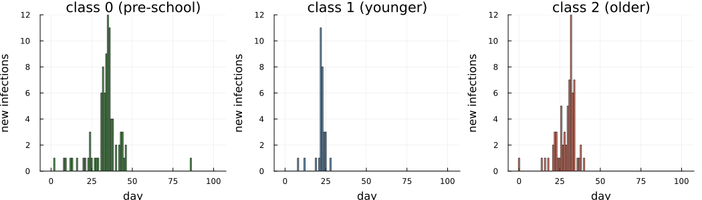
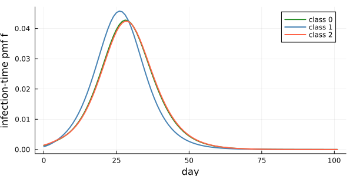
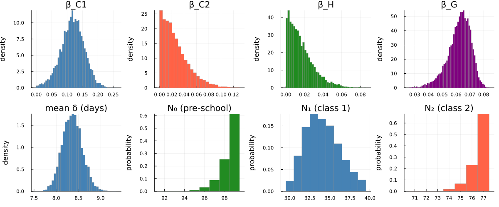
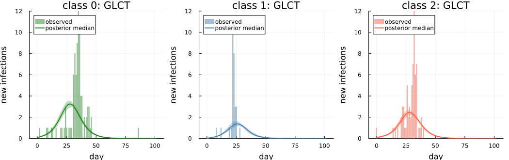
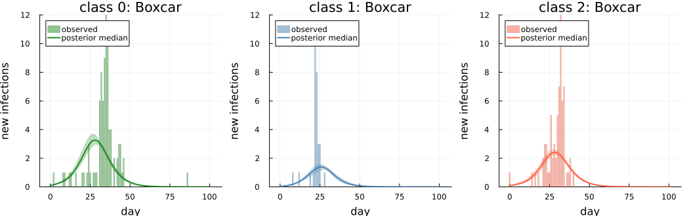
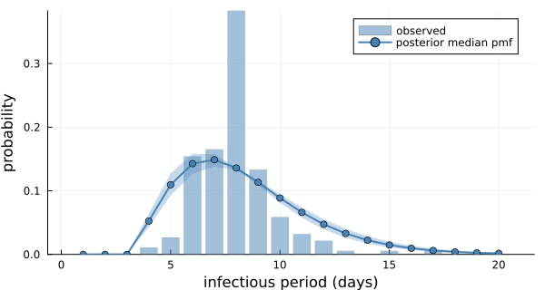
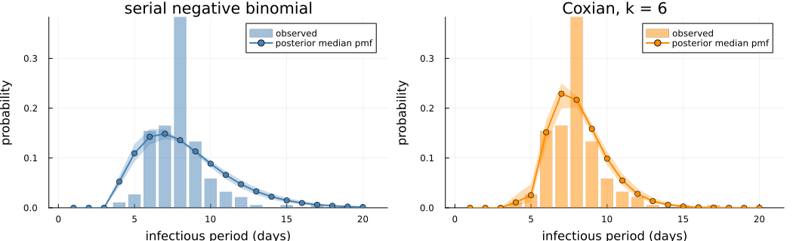
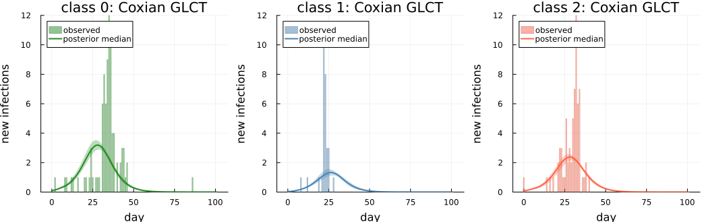

```@meta
EditURL = "measles_hagelloch.jl"
```

# Measles in Hagelloch, 1861: a custom three-group model

!!! note "Precomputed with the manuscript settings"
    The output on this page was precomputed using the manuscript's MCMC settings, with a target acceptance rate of 0.95, and is
    displayed without being re-evaluated. To rerun it, see [Reproducibility](../reproducibility.md).

This vignette reproduces the Hagelloch analysis of the manuscript. It is
also the package's worked example of a **custom multi-group model**. The standard workflow
([`DDSAModel`](@ref), [`fit_ddsa`](@ref)) covers one population; here three groups with their
own force of infection are written as a Turing model from the building blocks:
[`forward_map`](@ref) with a callable force of infection, [`ddsa_loglikelihood`](@ref) per group,
[`recovery_loglik`](@ref), and the integer-parameter helpers [`NGrid`](@ref) and
[`marginal_r_loglik`](@ref).

## The question

The 1861 measles outbreak in Hagelloch (188 cases among the village children) was analysed at the
individual level by Neal & Roberts (2004, "NR"), whose model ``M_\theta`` has within-class,
household and global transmission. Can a mean-field DDSA analogue with three groups recover the
qualitative structure of that model? The groups are the school classes:

- class 0: children not yet at school (pre-school);
- class 1: the younger school class;
- class 2: the older school class, which contains the index case.

The questions are whether the fit gives ``\beta_{C1} > \beta_{C2}`` for the within-class rates
of classes 1 and 2, a household rate ``\beta_H > 0`` from the school classes to class 0, the
right order of the three epidemics, and the group sizes ``N_0, N_1, N_2``. NR treat the group
sizes as known; DDSA infers them from the final-size terms. The same model is fitted with the
GLCT and the Boxcar forward maps, and their agreement checks the implementation.

The last section goes beyond the manuscript's analysis. It replaces the serial negative binomial
infectious period with a Coxian discrete phase-type distribution on the same GLCT map, which
removes the bound on its number of stages.

````julia
using DiscreteDynamicSurvivalAnalysis
using CSV, DataFrames, Distributions, Turing, MCMCChains
using LinearAlgebra, Random, Statistics
using Plots, StatsPlots, Measures

const FULL = get(ENV, "DDSA_FULL", "false") == "true"
t_start = time()
````

All fits here use NUTS with a target acceptance rate of 0.95 rather than the manuscript's 0.8.
At 0.8 the Coxian fit makes divergent transitions; smaller steps avoid them, and using them for
every fit keeps the fits comparable.

````julia
const NDRAWS = FULL ? 2000 : 100          # draws per chain after adaptation
const NCHAINS = FULL ? 4 : 2
const SAMPLER = NUTS(FULL ? 1000 : 100, 0.95; max_depth = 12, Δ_max = 1000.0)
const NPPC = FULL ? 200 : 100              # posterior draws used for the predictive checks
(; FULL, NDRAWS, NCHAINS, SAMPLER, NPPC, threads = Threads.nthreads())
````

````
(FULL = true, NDRAWS = 2000, NCHAINS = 4, SAMPLER = Turing.Inference.NUTS{ADTypes.AutoForwardDiff{nothing, Nothing}, AdvancedHMC.DiagEuclideanMetric}(1000, 0.95, 12, 1000.0, 0.0, ADTypes.AutoForwardDiff()), NPPC = 200, threads = 10)
````

## Inputs

The line list is distributed with the package (see `data/README.md` for its provenance). The
column `t_infection` is the prodrome onset in days since the first prodrome, and `inf_period` is
the infectious period with NR's offset already added: infectious from 1 day before prodrome
until 3 days after rash onset, so `inf_period = t_rash − t_infection + 4`.

````julia
df = CSV.read(example_data_path(:hagelloch), DataFrame)
cls = parse.(Int, string.(df.class))       # the column may parse as Int or String
classes = [df[cls .== c, :] for c in 0:2]
first(df[:, [:case_ID, :infector, :class, :t_infection, :t_rash, :inf_period]], 5)
````

```@raw html
<div><div style = "float: left;"><span>5×6 DataFrame</span></div><div style = "clear: both;"></div></div><div class = "data-frame" style = "overflow-x: scroll;"><table class = "data-frame" style = "margin-bottom: 6px;"><thead><tr class = "columnLabelRow"><th class = "stubheadLabel" style = "font-weight: bold; text-align: right;">Row</th><th style = "text-align: left;">case_ID</th><th style = "text-align: left;">infector</th><th style = "text-align: left;">class</th><th style = "text-align: left;">t_infection</th><th style = "text-align: left;">t_rash</th><th style = "text-align: left;">inf_period</th></tr><tr class = "columnLabelRow"><th class = "stubheadLabel" style = "font-weight: bold; text-align: right;"></th><th title = "Int64" style = "text-align: left;">Int64</th><th title = "DataStrings.DataString" style = "text-align: left;">DataStri…</th><th title = "Int64" style = "text-align: left;">Int64</th><th title = "Int64" style = "text-align: left;">Int64</th><th title = "Int64" style = "text-align: left;">Int64</th><th title = "Int64" style = "text-align: left;">Int64</th></tr></thead><tbody><tr class = "dataRow"><td class = "rowLabel" style = "font-weight: bold; text-align: right;">1</td><td style = "text-align: right;">1</td><td style = "text-align: left;">45</td><td style = "text-align: right;">1</td><td style = "text-align: right;">22</td><td style = "text-align: right;">26</td><td style = "text-align: right;">8</td></tr><tr class = "dataRow"><td class = "rowLabel" style = "font-weight: bold; text-align: right;">2</td><td style = "text-align: right;">2</td><td style = "text-align: left;">45</td><td style = "text-align: right;">1</td><td style = "text-align: right;">24</td><td style = "text-align: right;">28</td><td style = "text-align: right;">8</td></tr><tr class = "dataRow"><td class = "rowLabel" style = "font-weight: bold; text-align: right;">3</td><td style = "text-align: right;">3</td><td style = "text-align: left;">172</td><td style = "text-align: right;">0</td><td style = "text-align: right;">29</td><td style = "text-align: right;">33</td><td style = "text-align: right;">8</td></tr><tr class = "dataRow"><td class = "rowLabel" style = "font-weight: bold; text-align: right;">4</td><td style = "text-align: right;">4</td><td style = "text-align: left;">180</td><td style = "text-align: right;">2</td><td style = "text-align: right;">28</td><td style = "text-align: right;">29</td><td style = "text-align: right;">5</td></tr><tr class = "dataRow"><td class = "rowLabel" style = "font-weight: bold; text-align: right;">5</td><td style = "text-align: right;">5</td><td style = "text-align: left;">45</td><td style = "text-align: right;">1</td><td style = "text-align: right;">23</td><td style = "text-align: right;">28</td><td style = "text-align: right;">9</td></tr></tbody></table></div>
```

The three groups share one calendar grid. As in the manuscript, the grid covers the last
infection (day `Tmax`) plus about two mean infectious periods.

````julia
Tmax = maximum(df.t_infection)
nsteps = Tmax + 2 * round(Int, mean(df.inf_period))
groups = [linelist(d.t_infection, d.t_infection .+ d.inf_period; nsteps = nsteps) for d in classes]
````

````
3-element Vector{LineList}:
 LineList(nsteps = 102, Δt = 1.0, final_size = 90, known infection times = 90, recovery intervals = 90)
 LineList(nsteps = 102, Δt = 1.0, final_size = 30, known infection times = 30, recovery intervals = 30)
 LineList(nsteps = 102, Δt = 1.0, final_size = 68, known infection times = 68, recovery intervals = 68)
````

Each group is a [`LineList`](@ref) on the same `nsteps`-day grid (day `d` is step `d + 1`). The
recovery intervals are pooled over the groups, because the infectious period is shared.

````julia
delta = reduce(vcat, [g.recovery_intervals for g in groups])
K0, K1, K2 = (g.final_size for g in groups)
(; K0, K1, K2, nsteps, mean_delta = mean(delta), min_delta = minimum(delta),
 max_delta = maximum(delta), cv_delta = std(delta) / mean(delta))
````

````
(K0 = 90, K1 = 30, K2 = 68, nsteps = 102, mean_delta = 7.946808510638298, min_delta = 4, max_delta = 17, cv_delta = 0.21882175545294807)
````

The coefficient of variation of the recovery intervals (≈ 0.22) is far below the ≈ 0.94 of a
geometric distribution with the same mean, so the infectious period is modelled as a negative
binomial (DPH) distribution.

Infection-time histograms of the three groups:

````julia
ymax = maximum(maximum(g.infection_counts) for g in groups)
plot([bar(0:(nsteps - 1), g.infection_counts; title = t, color = c, alpha = 0.7, label = "",
          xlabel = "day", ylabel = "new infections", ylims = (0, ymax))
      for (g, t, c) in zip(groups, ["class 0 (pre-school)", "class 1 (younger)", "class 2 (older)"],
                           [:forestgreen, :steelblue, :tomato])]...;
     layout = (1, 3), size = (1050, 300), left_margin = 4mm, bottom_margin = 4mm)
````



The `infector` column (NR's reconstruction of who infected whom) shows that most pre-school
cases were infected by a school child, which motivates the household term ``\beta_H``.

````julia
class_of = Dict(zip(df.case_ID, cls))
infector_class = [get(class_of, something(tryparse(Int, string(x)), -1), missing) for x in classes[1].infector]
(from_school = count(c -> !ismissing(c) && c in (1, 2), infector_class),
 from_class0 = count(c -> !ismissing(c) && c == 0, infector_class),
 unresolved = count(ismissing, infector_class), K0 = K0)
````

````
(from_school = 53, from_class0 = 34, unresolved = 3, K0 = 90)
````

## Model configuration

### Force of infection: the callable `foi` interface

For `G` groups, [`forward_map`](@ref) takes a vector `ρ` of initially infected fractions and a
force of infection `foi` that maps the vector `I` of infected fractions (one per group) to one
infection rate per group. Group ``k`` then has new infections
``(1 - e^{-\mathrm{rate}_k \Delta t}) S_k`` per step, where ``S_k`` is its susceptible fraction
and ``\Delta t = 1`` day the step length. A matrix `B` gives `B * I`; any callable works, for
example a closure over the parameters. The analogue of NR's ``M_\theta`` (household, two
classroom and one global term, with the spatial decay switched off) is:

````julia
mtheta_foi(β_C1, β_C2, β_H, β_G) = I -> begin
    Itot = I[1] + I[2] + I[3]
    [β_H * (I[2] + I[3]) + β_G * Itot,     # class 0: household route from school children + global
     β_C1 * I[2] + β_G * Itot,             # class 1: within class 1 + global
     β_C2 * I[3] + β_G * Itot]             # class 2: within class 2 + global
end
````

````
mtheta_foi (generic function with 1 method)
````

The closure must accept vectors of ForwardDiff `Dual`s, because NUTS differentiates through the
map. A matrix would do here too, since this force of infection is linear in `I`. A callable is
needed for non-linear forces of infection (e.g. saturating contact rates).

The global term ``\beta_G (I_0 + I_1 + I_2)`` includes all three groups, so pre-school children
also infect school children through ``\beta_G``. The next-generation matrix used below for the
basic reproduction number ``R_0`` uses the same rates.

### Infectious period

The calendar infectious period ``\delta`` has a minimum of ``\delta_{\min} = 4`` days (NR's
offset). It is a negative binomial with ``r`` stages, preceded by ``\delta_{\min} - r``
deterministic one-day states ([`dph_negative_binomial_min_support`](@ref)), so its support is
``\{\delta_{\min}, \delta_{\min} + 1, \ldots\}``. NUTS samples its mean ``E[\delta]``, and
``p = r / (E[\delta] - \delta_{\min} + r)``; ``r \in \{1, \ldots, \delta_{\min}\}`` is summed
out.

````julia
δ_floor = minimum(delta)
r_max = δ_floor
dph_nominal = dph_negative_binomial_min_support(r_max, r_max / (mean(delta) - δ_floor + r_max), δ_floor)
(; δ_floor, r_max, mean = mean(dph_nominal))
````

````
(δ_floor = 4, r_max = 4, mean = 7.946808510638297)
````

The Boxcar map needs a number of infection-age classes. As in the manuscript it is the 99.99th
percentile of a nominal infectious period (`dph_nominal`: ``r = \delta_{\min}`` and ``E[\delta]``
equal to the mean recorded interval), but at least 40. The hazard is the exact one of
``\min(\delta, K_{\text{age}})`` (`truncation = :absorb`).

````julia
K_age = max(40, findfirst(k -> cdf(dph_nominal, k) ≥ 0.9999, 1:200))
````

````
40
````

One forward-map run at the manuscript's posterior medians shows the three epidemics: class 1
first, then class 2 and the pre-school children almost together. The index case is in class 2
(``\rho_2 = 1/N_2``, ``\rho_0 = \rho_1 = 0``).

````julia
foi_demo = mtheta_foi(0.1174, 0.021, 0.0124, 0.0638)
dph_demo = dph_negative_binomial_min_support(4, 4 / (8.3537 - δ_floor + 4), δ_floor)
sol_demo = forward_map(GLCT(dph_demo), foi_demo, [0.0, 0.0, 1 / 77], nsteps)
B_demo = [0.0638 0.0124+0.0638 0.0124+0.0638; 0.0638 0.1174+0.0638 0.0638; 0.0638 0.0638 0.021+0.0638]
sol_B = forward_map(GLCT(dph_demo), B_demo, [0.0, 0.0, 1 / 77], nsteps)
(τ = round.(sol_demo.τ; digits = 3), same_as_matrix_form = sol_demo.τ ≈ sol_B.τ)
````

````
(τ = [0.767, 0.884, 0.748], same_as_matrix_form = true)
````

````julia
plot(0:(nsteps - 1), sol_demo.f; label = ["class 0" "class 1" "class 2"],
     color = [:forestgreen :steelblue :tomato], xlabel = "day", ylabel = "infection-time pmf f",
     linewidth = 2, size = (600, 300))
````



### Populations

The group sizes are unknown. Pfeilsticker (1863, as cited by NR) recorded 197 children under 14,
so with all 197 children in one of the three groups and ``K_k`` cases in group ``k``, group ``k``
has at most ``N_{k,\max} = 197 - K_{k'} - K_{k''}`` members (``k'``, ``k''`` are the other two
groups). Each ``N_k`` has a discrete uniform prior on ``\{K_k, \ldots, N_{k,\max}\}``.

- ``N_0`` and ``N_1`` only enter their final-size terms. They are summed out with an
  [`NGrid`](@ref) (the `population` argument of [`ddsa_loglikelihood`](@ref)).
- ``N_2`` also sets the seed ``\rho_2``, and so changes the map. It is summed out
  together with ``r`` over a grid of cells, one forward-map run per cell.

````julia
N_total = 197
N0_max, N1_max, N2_max = N_total - K1 - K2, N_total - K0 - K2, N_total - K0 - K1
N0_grid = NGrid(K0, K0, N0_max)
N1_grid = NGrid(K1, K1, N1_max)
N2_values = K2:N2_max
cells = vec(collect(Iterators.product(1:r_max, N2_values)))   # (r, N2) pairs
(; N0 = K0:N0_max, N1 = K1:N1_max, N2 = N2_values, ncells = length(cells))
````

````
(N0 = 90:99, N1 = 30:39, N2 = 68:77, ncells = 40)
````

### Likelihood of one (r, N2) cell

For given transmission rates, infectious-period DPH (here the one with ``r`` stages) and
``N_2``, the log-likelihood is the sum of:

- per group, the final-size and infection-time terms (`ddsa_loglikelihood` with
  `group = g`), with ``N_0``, ``N_1`` summed out and ``N_2`` known in the cell. `group_terms`
  computes them for any DPH and infection structure;
- once, the recovery term of the pooled intervals. It depends on the DPH but not on ``N_2``, so
  the model below computes it once per DPH and adds it to that DPH's cells.

The manuscript's numerical guard clamps the attack fraction ``\tau_k`` of each group (its expected
fraction infected) to ``[0.001, 0.999]``. `group_terms` also returns the guarded ``\tau_0`` and
``\tau_1``, which are used later to draw ``N_0`` and ``N_1``.

````julia
hd = (; groups, delta, δ_floor, r_max, nsteps, N0_grid, N1_grid, N2_values,
      guards = NumericalGuards(τ_bounds = (0.001, 0.999)))

# infectious period with r stages and mean mean_δ: p = r / (E[δ] − δ_min + r)
hagelloch_dph(hd, r, mean_δ) = dph_negative_binomial_min_support(r, r / (mean_δ - hd.δ_floor + r), hd.δ_floor)

function group_terms(hd, structure, dph, foi, N2)
    sol = forward_map(structure, foi, [0.0, 0.0, 1 / N2], hd.nsteps)
    ll = zero(eltype(dph.s))
    τ = zeros(eltype(dph.s), 3)
    for (g, pop) in enumerate((hd.N0_grid, hd.N1_grid, N2))
        res = ddsa_loglikelihood(sol, hd.groups[g], dph; population = pop, group = g, guards = hd.guards,
                                 terms = (:final_size, :infection_times))
        ll += res.loglik
        τ[g] = res.τ
    end
    return (ll = ll, τ0 = τ[1], τ1 = τ[2])
end
````

````
group_terms (generic function with 1 method)
````

### Infectious-period model

The infectious period is a small Turing model of its own. It samples its parameters and returns
one DPH for each value of its integer parameter, which is summed out together with ``N_2``. For
the serial negative binomial, NUTS samples ``E[\delta]`` and the model returns the DPHs with
``r = 1, \ldots, 4`` stages. Another law only needs another such model; the last section uses a
Coxian DPH.

````julia
@model function serial_negbin(hd)
    mean_δ ~ Uniform(hd.δ_floor + 0.5, 25.0)
    return [hagelloch_dph(hd, r, mean_δ) for r in 1:hd.r_max]
end
````

````
serial_negbin (generic function with 2 methods)
````

### Turing model

NUTS samples the four transmission rates and the parameters of the infectious-period model
`ip`, which enters as a submodel. The cells pair each DPH that `ip` returns with each value of
``N_2`` (40 cells for the serial negative binomial). They are summed out with
[`marginal_r_loglik`](@ref), evaluated as parallel tasks (`threaded = true`), with a uniform
prior over the cells. The recovery term and the infection structure are computed once per DPH,
and `make_structure` turns a DPH into the infection structure of the map, GLCT or Boxcar.
The model returns the per-cell log-likelihoods, the DPHs and the cells, from which the integer
parameters are drawn after sampling.

````julia
@model function hagelloch_mtheta(hd, ip, make_structure)
    beta_C1 ~ Exponential(0.2)
    beta_C2 ~ Exponential(0.1)
    beta_H ~ Exponential(0.1)
    beta_G ~ Exponential(0.1)
    dphs ~ to_submodel(ip, false)                      # false: keep the submodel's parameter names
    foi = mtheta_foi(beta_C1, beta_C2, beta_H, beta_G)
    rec = [recovery_loglik(d, hd.delta) for d in dphs]
    structures = [make_structure(d) for d in dphs]
    cells = vec(collect(Iterators.product(eachindex(dphs), hd.N2_values)))
    logmarg, lps = marginal_r_loglik(cells; threaded = true) do (v, N2)
        group_terms(hd, structures[v], dphs[v], foi, N2).ll + rec[v]
    end
    Turing.@addlogprob! logmarg
    return (lps = lps, dphs = dphs, cells = cells)
end

glct_structure(dph) = GLCT(dph)
boxcar_structure(dph) = Boxcar(dph, K_age)     # truncation = :absorb
model_glct = hagelloch_mtheta(hd, serial_negbin(hd), glct_structure)
model_boxcar = hagelloch_mtheta(hd, serial_negbin(hd), boxcar_structure)
logjoint(model_glct, (beta_C1 = 0.1174, beta_C2 = 0.021, beta_H = 0.0124, beta_G = 0.0638, mean_δ = 8.3537))
````

````
-651.1609553268783
````

## Fit

The chains start from jittered data-based values, as in the manuscript: the transmission rates
at their prior medians and the infectious-period parameters from the recorded intervals (for the
serial negative binomial, ``E[\delta]`` at their mean), each multiplied by ``e^{0.1 z}`` with
``z \sim \mathcal{N}(0, 1)``. `ip_init` gives the infectious-period part.

````julia
jitter(rng) = exp(0.1 * randn(rng))
serial_init(rng, hd) = (mean_δ = clamp(jitter(rng) * mean(hd.delta), minimum(hd.delta) + 0.6, 24.9),)

function data_inits(rng, hd, n, ip_init)
    return [InitFromParams(merge((beta_C1 = jitter(rng) * median(Exponential(0.2)),
                                  beta_C2 = jitter(rng) * median(Exponential(0.1)),
                                  beta_H = jitter(rng) * median(Exponential(0.1)),
                                  beta_G = jitter(rng) * median(Exponential(0.1))), ip_init(rng, hd)))
            for _ in 1:n]
end
````

````
data_inits (generic function with 1 method)
````

After sampling, each draw gets integer values from their conditional posteriors.

1. A cell (a DPH and ``N_2``) is drawn from the returned per-cell log-likelihoods
   ([`sample_index`](@ref)).
2. The map of that cell is rerun to get the attack fractions of classes 0 and 1.
3. ``N_0`` and ``N_1`` are drawn given those attack fractions ([`sample_N`](@ref)).

The draws are added to the chain as `:N0`, `:N1` and `:N2` and, when the infectious-period model
returns several DPHs, the index of the drawn one under the name `variant` (here `:r`).

````julia
function add_integer_draws(rng, hd, model, chain, make_structure; variant = :r)
    rets = returned(model, chain)
    niter, nch = size(rets)
    betas = [Array(chain[s]) for s in (:beta_C1, :beta_C2, :beta_H, :beta_G)]
    names = variant === nothing ? [:N0, :N1, :N2] : [variant, :N0, :N1, :N2]
    draws = zeros(Int, niter, length(names), nch)
    for c in 1:nch, i in 1:niter
        (; lps, dphs, cells) = rets[i, c]
        v, N2 = cells[sample_index(rng, lps)]
        foi = mtheta_foi((b[i, c] for b in betas)...)
        cell = group_terms(hd, make_structure(dphs[v]), dphs[v], foi, N2)
        Ns = [sample_N(rng, hd.N0_grid, cell.τ0), sample_N(rng, hd.N1_grid, cell.τ1), N2]
        draws[i, :, c] = variant === nothing ? Ns : [v; Ns]
    end
    return hcat(chain, MCMCChains.setrange(Chains(draws, names), range(chain)))
end

function fit_mtheta(rng, hd, model, make_structure, ip_init; variant = :r)
    chain = sample(rng, model, SAMPLER, MCMCThreads(), NDRAWS, NCHAINS; progress = false,
                   chain_type = Chains, initial_params = data_inits(rng, hd, NCHAINS, ip_init))
    return add_integer_draws(rng, hd, model, chain, make_structure; variant)
end

t_glct = @elapsed chain_glct = fit_mtheta(Xoshiro(20261006), hd, model_glct, glct_structure, serial_init)
t_boxcar = @elapsed chain_boxcar = fit_mtheta(Xoshiro(20261007), hd, model_boxcar, boxcar_structure, serial_init)
divergences(chain) = Int(sum(Array(chain[:numerical_error])))
(seconds_glct = round(t_glct; digits = 1), seconds_boxcar = round(t_boxcar; digits = 1),
 divergent_transitions = (glct = divergences(chain_glct), boxcar = divergences(chain_boxcar)))
````

````
(seconds_glct = 189.9, seconds_boxcar = 270.8, divergent_transitions = (glct = 0, boxcar = 0))
````

Convergence diagnostics (bulk/tail effective sample sizes and ``\hat R``) of the GLCT fit:

````julia
summarystats(chain_glct)
````

````
Summary Statistics

  parameters      mean       std      mcse    ess_bulk    ess_tail      rhat   ⋯
      Symbol   Float64   Float64   Float64     Float64     Float64   Float64   ⋯

     beta_C1    0.1179    0.0379    0.0010   1473.7221   1509.2461    1.0020   ⋯
     beta_C2    0.0266    0.0213    0.0005   1514.8559   1907.4623    1.0006   ⋯
      beta_H    0.0167    0.0134    0.0003   1801.5528   2160.8512    1.0019   ⋯
      beta_G    0.0624    0.0083    0.0002   1261.2182   1470.9380    1.0018   ⋯
      mean_δ    8.3607    0.2245    0.0036   3843.1225   4136.7493    1.0004   ⋯
           r    3.9996    0.0194    0.0002   8020.6465         NaN    0.9999   ⋯
          N0   98.4190    0.8926    0.0105   7230.0248         NaN    1.0000   ⋯
          N1   34.0812    2.1180    0.0273   6090.4181   6947.4388    1.0007   ⋯
          N2   76.5683    0.7279    0.0081   8122.7750         NaN    0.9998   ⋯

                                                                1 column omitted

````

and of the Boxcar fit:

````julia
summarystats(chain_boxcar)
````

````
Summary Statistics

  parameters      mean       std      mcse    ess_bulk    ess_tail      rhat   ⋯
      Symbol   Float64   Float64   Float64     Float64     Float64   Float64   ⋯

     beta_C1    0.1176    0.0374    0.0009   1953.6892   2092.9542    1.0014   ⋯
     beta_C2    0.0261    0.0213    0.0005   1798.8936   2239.5107    1.0024   ⋯
      beta_H    0.0166    0.0136    0.0003   1867.0391   2334.9041    1.0018   ⋯
      beta_G    0.0625    0.0083    0.0002   1658.2121   1605.9197    1.0019   ⋯
      mean_δ    8.3638    0.2263    0.0035   4188.0089   3413.8530    1.0006   ⋯
           r    4.0000    0.0000       NaN         NaN         NaN       NaN   ⋯
          N0   98.4232    0.8889    0.0099   8020.6003         NaN    0.9997   ⋯
          N1   34.1135    2.1509    0.0262   6887.4050   7257.9506    0.9999   ⋯
          N2   76.5580    0.7496    0.0082   8367.9887         NaN    0.9998   ⋯

                                                                1 column omitted

````

## Results

### Basic reproduction number

``R_0`` is the dominant eigenvalue of the next-generation matrix ``\mathcal{K}``. Its entry
``\mathcal{K}_{ij}`` is the expected number of infections in group ``i`` caused by one infective
of group ``j`` in a fully susceptible population:
``\mathcal{K}_{ij} = (N_i / N_j)\, \beta_{ij}\, E[\delta]``, where ``\beta_{ij}`` is the
coefficient of ``I_j`` in the rate of group ``i``. The factor ``N_i/N_j`` appears because the
state variables are per-group fractions. It uses the calendar mean ``E[\delta]``, offset days included.

````julia
function compute_R0_mtheta(beta_C1, beta_C2, beta_H, beta_G, mean_ip, N0, N1, N2)
    K = mean_ip .* [(N0 / N0)*beta_G  (N0 / N1)*(beta_H + beta_G)  (N0 / N2)*(beta_H + beta_G);
                    (N1 / N0)*beta_G  (N1 / N1)*(beta_C1 + beta_G) (N1 / N2)*beta_G;
                    (N2 / N0)*beta_G  (N2 / N1)*beta_G             (N2 / N2)*(beta_C2 + beta_G)]
    return maximum(real(eigvals(K)))
end

pooled(chain, s) = vec(Array(chain[s]))     # chain 1 first, then chain 2, …
````

````
pooled (generic function with 1 method)
````

The infectious-period DPH of each draw is that of the infectious-period model at the draw's
parameters, for the drawn `variant`. `posterior_quantities` collects the draws of the
parameters, the mean ``E[\delta]``, the per-stage progression probability ``p`` (that of the
last stage), the coefficient of variation ``\text{CV}_\delta`` of the infectious period and ``R_0``.

````julia
function posterior_dphs(chain, ip; variant = :r)
    rets = returned(ip, chain)
    pick(i, c) = variant === nothing ? 1 : Int(chain[variant][i, c])
    return vec([rets[i, c][pick(i, c)] for i in axes(rets, 1), c in axes(rets, 2)])
end

dph_cv(d) = sqrt(var(d)) / mean(d)

function posterior_quantities(chain, dphs)
    d = Dict{Symbol,Vector{Float64}}(s => pooled(chain, s) for s in (:beta_C1, :beta_C2, :beta_H, :beta_G,
                                                                     :N0, :N1, :N2))
    :r in names(chain) && (d[:r] = pooled(chain, :r))
    d[:mean_δ] = mean.(dphs)
    d[:p] = [1 - x.S[end, end] for x in dphs]
    d[:cv_δ] = dph_cv.(dphs)
    d[:R0] = [compute_R0_mtheta(d[:beta_C1][i], d[:beta_C2][i], d[:beta_H][i], d[:beta_G][i], d[:mean_δ][i],
                                d[:N0][i], d[:N1][i], d[:N2][i]) for i in eachindex(dphs)]
    return d
end

dphs_glct = posterior_dphs(chain_glct, serial_negbin(hd))
dphs_boxcar = posterior_dphs(chain_boxcar, serial_negbin(hd))
post_glct = posterior_quantities(chain_glct, dphs_glct)
post_boxcar = posterior_quantities(chain_boxcar, dphs_boxcar)
````

### Posterior table

Posterior medians and 95% credible intervals of both fits, with the GLCT medians reported by the
manuscript (full settings).

````julia
manuscript_glct = Dict(:beta_C1 => 0.1174, :beta_C2 => 0.0210, :beta_H => 0.0124, :beta_G => 0.0638,
                       :mean_δ => 8.3537, :r => 4, :N0 => 99, :N1 => 34, :N2 => 77, :R0 => 2.167)
fmt(v) = string(round(median(v); sigdigits = 3), " [", round(quantile(v, 0.025); sigdigits = 3), ", ",
                round(quantile(v, 0.975); sigdigits = 3), "]")
params = [:beta_C1, :beta_C2, :beta_H, :beta_G, :mean_δ, :p, :r, :N0, :N1, :N2, :R0]
DataFrame(parameter = String.(params), GLCT = [fmt(post_glct[s]) for s in params],
          Boxcar = [fmt(post_boxcar[s]) for s in params],
          manuscript_GLCT_median = [get(manuscript_glct, s, missing) for s in params])
````

```@raw html
<div><div style = "float: left;"><span>11×4 DataFrame</span></div><div style = "clear: both;"></div></div><div class = "data-frame" style = "overflow-x: scroll;"><table class = "data-frame" style = "margin-bottom: 6px;"><thead><tr class = "columnLabelRow"><th class = "stubheadLabel" style = "font-weight: bold; text-align: right;">Row</th><th style = "text-align: left;">parameter</th><th style = "text-align: left;">GLCT</th><th style = "text-align: left;">Boxcar</th><th style = "text-align: left;">manuscript_GLCT_median</th></tr><tr class = "columnLabelRow"><th class = "stubheadLabel" style = "font-weight: bold; text-align: right;"></th><th title = "String" style = "text-align: left;">String</th><th title = "String" style = "text-align: left;">String</th><th title = "String" style = "text-align: left;">String</th><th title = "Union{Missing, Real}" style = "text-align: left;">Real?</th></tr></thead><tbody><tr class = "dataRow"><td class = "rowLabel" style = "font-weight: bold; text-align: right;">1</td><td style = "text-align: left;">beta_C1</td><td style = "text-align: left;">0.119 [0.0373, 0.189]</td><td style = "text-align: left;">0.119 [0.0384, 0.189]</td><td style = "text-align: right;">0.1174</td></tr><tr class = "dataRow"><td class = "rowLabel" style = "font-weight: bold; text-align: right;">2</td><td style = "text-align: left;">beta_C2</td><td style = "text-align: left;">0.0216 [0.000845, 0.0801]</td><td style = "text-align: left;">0.0209 [0.000845, 0.0794]</td><td style = "text-align: right;">0.021</td></tr><tr class = "dataRow"><td class = "rowLabel" style = "font-weight: bold; text-align: right;">3</td><td style = "text-align: left;">beta_H</td><td style = "text-align: left;">0.0136 [0.00065, 0.0511]</td><td style = "text-align: left;">0.0133 [0.00054, 0.0509]</td><td style = "text-align: right;">0.0124</td></tr><tr class = "dataRow"><td class = "rowLabel" style = "font-weight: bold; text-align: right;">4</td><td style = "text-align: left;">beta_G</td><td style = "text-align: left;">0.0634 [0.0429, 0.0758]</td><td style = "text-align: left;">0.0636 [0.0431, 0.0758]</td><td style = "text-align: right;">0.0638</td></tr><tr class = "dataRow"><td class = "rowLabel" style = "font-weight: bold; text-align: right;">5</td><td style = "text-align: left;">mean_δ</td><td style = "text-align: left;">8.36 [7.93, 8.81]</td><td style = "text-align: left;">8.36 [7.93, 8.83]</td><td style = "text-align: right;">8.3537</td></tr><tr class = "dataRow"><td class = "rowLabel" style = "font-weight: bold; text-align: right;">6</td><td style = "text-align: left;">p</td><td style = "text-align: left;">0.479 [0.454, 0.504]</td><td style = "text-align: left;">0.479 [0.453, 0.504]</td><td style = "font-style: italic; text-align: right;">missing</td></tr><tr class = "dataRow"><td class = "rowLabel" style = "font-weight: bold; text-align: right;">7</td><td style = "text-align: left;">r</td><td style = "text-align: left;">4.0 [4.0, 4.0]</td><td style = "text-align: left;">4.0 [4.0, 4.0]</td><td style = "text-align: right;">4</td></tr><tr class = "dataRow"><td class = "rowLabel" style = "font-weight: bold; text-align: right;">8</td><td style = "text-align: left;">N0</td><td style = "text-align: left;">99.0 [96.0, 99.0]</td><td style = "text-align: left;">99.0 [96.0, 99.0]</td><td style = "text-align: right;">99</td></tr><tr class = "dataRow"><td class = "rowLabel" style = "font-weight: bold; text-align: right;">9</td><td style = "text-align: left;">N1</td><td style = "text-align: left;">34.0 [31.0, 39.0]</td><td style = "text-align: left;">34.0 [30.0, 39.0]</td><td style = "text-align: right;">34</td></tr><tr class = "dataRow"><td class = "rowLabel" style = "font-weight: bold; text-align: right;">10</td><td style = "text-align: left;">N2</td><td style = "text-align: left;">77.0 [75.0, 77.0]</td><td style = "text-align: left;">77.0 [75.0, 77.0]</td><td style = "text-align: right;">77</td></tr><tr class = "dataRow"><td class = "rowLabel" style = "font-weight: bold; text-align: right;">11</td><td style = "text-align: left;">R0</td><td style = "text-align: left;">2.17 [2.02, 2.37]</td><td style = "text-align: left;">2.17 [2.02, 2.38]</td><td style = "text-align: right;">2.167</td></tr></tbody></table></div>
```

Comparison with the structure of NR's ``M_\theta``: the younger class has the higher
within-class rate, and the household rate is small. The mean-field ``\beta_H`` applies to all
(class 0) × (school) pairs, not only to siblings, and transmission not attributed to it is
absorbed by ``\beta_G``.

````julia
(β_C1_over_β_C2 = median(post_glct[:beta_C1]) / median(post_glct[:beta_C2]),
 β_H_over_β_G = median(post_glct[:beta_H]) / median(post_glct[:beta_G]),
 P_β_C1_gt_β_C2 = mean(post_glct[:beta_C1] .> post_glct[:beta_C2]))
````

````
(β_C1_over_β_C2 = 5.506686246629514, β_H_over_β_G = 0.21411378567487618, P_β_C1_gt_β_C2 = 0.99175)
````

Posterior distributions of the GLCT fit (integer parameters with one bin per value):

````julia
function posterior_panel(x; title, color, integer = false)
    histogram(x; bins = integer ? ((minimum(x) - 0.5):1:(maximum(x) + 0.5)) : :auto, normalize = :pdf,
              label = "", title = title, color = color, linecolor = :gray, linewidth = 0.3,
              ylabel = integer ? "probability" : "density")
end

plot(posterior_panel(post_glct[:beta_C1]; title = "β_C1", color = :steelblue),
     posterior_panel(post_glct[:beta_C2]; title = "β_C2", color = :tomato),
     posterior_panel(post_glct[:beta_H]; title = "β_H", color = :forestgreen),
     posterior_panel(post_glct[:beta_G]; title = "β_G", color = :purple),
     posterior_panel(post_glct[:mean_δ]; title = "mean δ (days)", color = :steelblue),
     posterior_panel(post_glct[:N0]; title = "N₀ (pre-school)", color = :forestgreen, integer = true),
     posterior_panel(post_glct[:N1]; title = "N₁ (class 1)", color = :steelblue, integer = true),
     posterior_panel(post_glct[:N2]; title = "N₂ (class 2)", color = :tomato, integer = true);
     layout = (2, 4), size = (1200, 500), left_margin = 4mm, bottom_margin = 4mm)
````



### Posterior predictive checks

For `NPPC` draws evenly spaced over the pooled chains, the map is rerun at the draw's parameters
(including its DPH and ``N_2``). The expected new infections per day of group ``k`` are
``N_k \tau_k f_k``, with ``N_k`` the draw's group size and ``f_k`` the group's infection-time
distribution, so the curves show the model's own
epidemic size. Each group's result is a [`PosteriorPredictive`](@ref), so the package's plot
recipe and [`predictive_quantiles`](@ref) apply.

````julia
function group_predictive(rng, hd, post, dphs, make_structure; ndraws)
    idx = unique(round.(Int, range(1, length(dphs); length = ndraws)))
    inc = [zeros(hd.nsteps, length(idx)) for _ in 1:3]
    τ = zeros(length(idx), 3)
    final = zeros(Int, length(idx), 3)
    for (j, i) in enumerate(idx)
        N = Int.((post[:N0][i], post[:N1][i], post[:N2][i]))
        dph = dphs[i]
        foi = mtheta_foi(post[:beta_C1][i], post[:beta_C2][i], post[:beta_H][i], post[:beta_G][i])
        sol = forward_map(make_structure(dph), foi, [0.0, 0.0, 1 / N[3]], hd.nsteps)
        for g in 1:3
            τ[j, g] = attack_fraction(sol, g)
            inc[g][:, j] .= N[g] * τ[j, g] .* infection_pmf(sol, g)
            final[j, g] = rand(rng, Binomial(N[g], clamp(τ[j, g], 0.0, 1.0)))
        end
    end
    times = collect(0.0:(hd.nsteps - 1))
    pps = [PosteriorPredictive(times, hd.groups[g].infection_counts, inc[g], final[:, g], hd.groups[g].final_size,
                               :expected) for g in 1:3]
    return (pps = pps, τ = τ, idx = idx)
end

ppc_glct = group_predictive(Xoshiro(1), hd, post_glct, dphs_glct, glct_structure; ndraws = NPPC)
ppc_boxcar = group_predictive(Xoshiro(2), hd, post_boxcar, dphs_boxcar, boxcar_structure; ndraws = NPPC)
````

Predicted ``\tau_k`` against the observed attack fractions ``K_k / N_k``, both per posterior
draw (GLCT). The mean-field model reproduces class 1 but
under-predicts the attack fractions of classes 0 and 2, whose internal contact structure is
heterogeneous (households, the older class).

````julia
qfmt(v) = string(round(median(v); digits = 3), " [", round(quantile(v, 0.025); digits = 3), ", ",
                 round(quantile(v, 0.975); digits = 3), "]")
DataFrame(group = ["class 0", "class 1", "class 2"],
          predicted_τ = [qfmt(ppc_glct.τ[:, g]) for g in 1:3],
          observed_K_over_N = [qfmt(K ./ post_glct[N][ppc_glct.idx]) for (K, N) in zip((K0, K1, K2), (:N0, :N1, :N2))])
````

```@raw html
<div><div style = "float: left;"><span>3×3 DataFrame</span></div><div style = "clear: both;"></div></div><div class = "data-frame" style = "overflow-x: scroll;"><table class = "data-frame" style = "margin-bottom: 6px;"><thead><tr class = "columnLabelRow"><th class = "stubheadLabel" style = "font-weight: bold; text-align: right;">Row</th><th style = "text-align: left;">group</th><th style = "text-align: left;">predicted_τ</th><th style = "text-align: left;">observed_K_over_N</th></tr><tr class = "columnLabelRow"><th class = "stubheadLabel" style = "font-weight: bold; text-align: right;"></th><th title = "String" style = "text-align: left;">String</th><th title = "String" style = "text-align: left;">String</th><th title = "String" style = "text-align: left;">String</th></tr></thead><tbody><tr class = "dataRow"><td class = "rowLabel" style = "font-weight: bold; text-align: right;">1</td><td style = "text-align: left;">class 0</td><td style = "text-align: left;">0.769 [0.712, 0.831]</td><td style = "text-align: left;">0.909 [0.909, 0.938]</td></tr><tr class = "dataRow"><td class = "rowLabel" style = "font-weight: bold; text-align: right;">2</td><td style = "text-align: left;">class 1</td><td style = "text-align: left;">0.882 [0.813, 0.918]</td><td style = "text-align: left;">0.882 [0.789, 0.968]</td></tr><tr class = "dataRow"><td class = "rowLabel" style = "font-weight: bold; text-align: right;">3</td><td style = "text-align: left;">class 2</td><td style = "text-align: left;">0.753 [0.691, 0.8]</td><td style = "text-align: left;">0.883 [0.883, 0.919]</td></tr></tbody></table></div>
```

The order of the epidemics: class 1 should peak before the main wave of class 2, and the
pre-school wave, driven by infections from school children, after class 1.

````julia
peak(pp) = [argmax(view(pp.incidence, :, j)) - 1 for j in axes(pp.incidence, 2)]   # day of the peak
peaks = peak.(ppc_glct.pps)
(mean_peak_day = round.(mean.(peaks); digits = 1),
 observed_peak_day = [argmax(g.infection_counts) - 1 for g in groups],
 P_class1_after_class2 = mean(peaks[2] .>= peaks[3]),
 P_class0_after_class1 = mean(peaks[1] .>= peaks[2]))
````

````
(mean_peak_day = [27.9, 26.1, 28.2], observed_peak_day = [35, 22, 32], P_class1_after_class2 = 0.045, P_class0_after_class1 = 0.995)
````

GLCT predictive checks (observed counts, posterior median and 95% band of the expected new
infections):

````julia
ppc_plot(ppc, model) = plot([plot(pp; title = "$t: $model", color = c, xlabel = "day", ylabel = "new infections",
                                 legend = :topleft)
                            for (pp, t, c) in zip(ppc.pps, ["class 0", "class 1", "class 2"],
                                                  [:forestgreen, :steelblue, :tomato])]...;
                           layout = (1, 3), size = (1050, 330), left_margin = 4mm, bottom_margin = 4mm,
                           link = :y)
ppc_plot(ppc_glct, "GLCT")
````



The Boxcar fit gives the same bands:

````julia
ppc_plot(ppc_boxcar, "Boxcar")
````



### Recovery intervals

The posterior infectious-period distribution against the pooled recorded intervals, as a
[`RecoveryPredictive`](@ref):

````julia
function recovery_check(dphs, hd; ndraws, max_interval = maximum(hd.delta) + 3)
    idx = unique(round.(Int, range(1, length(dphs); length = ndraws)))
    P = zeros(max_interval, length(idx))
    for (j, i) in enumerate(idx)
        P[:, j] .= [pdf(dphs[i], x) for x in 1:max_interval]
    end
    return RecoveryPredictive(1:max_interval, P, [count(==(x), hd.delta) for x in 1:max_interval])
end

rp = recovery_check(dphs_glct, hd; ndraws = NPPC)
plot(rp; xlabel = "infectious period (days)", size = (600, 320), color = :steelblue)
````



## A Coxian infectious period on the GLCT map

### The stage bound of the serial infectious period

The serial DPH passes through at most one stage per day, so ``r`` stages last at least ``r``
days and ``r \le \delta_{\min} = 4``. The posterior of ``r`` sits at that bound, and the fitted
infectious period is more variable than the 188 recorded intervals ``\delta`` (coefficients of
variation, CV):

````julia
cv_recorded, mean_recorded = std(delta) / mean(delta), mean(delta)
(P_r_at_bound = mean(post_glct[:r] .== r_max), recorded_cv = round(cv_recorded; digits = 3),
 fitted_cv = qfmt(post_glct[:cv_δ]))
````

````
(P_r_at_bound = 0.999625, recorded_cv = 0.219, fitted_cv = "0.361 [0.352, 0.369]")
````

A DPH with ``k`` stages and mean ``m > k`` has a squared CV of at least ``1/k - 1/m``, and the
negative binomial attains it (Telek, 2000). With the mean of the recorded intervals, reaching
their CV therefore needs at least this many stages, more than a serial chain can have here:

````julia
k_cox = ceil(Int, 1 / (cv_recorded^2 + 1 / mean_recorded))
````

````
6
````

### A Coxian DPH

In a Coxian DPH the stages are still passed in order, at most one per day, but an individual can
leave after any of several stages. Here the chain has ``k = 6`` stages with a common per-day
progression probability ``p``, and an individual leaves after stage ``j \in \{4, 5, 6\}`` with
probability ``w_j`` (``w_4 + w_5 + w_6 = 1``). No one leaves before stage ``\delta_{\min}``,
because no recorded interval is shorter. The infectious period is a mixture of negative binomials,

```math
P(\delta = n) = \sum_{j=4}^{6} w_j \binom{n-1}{j-1} p^j (1-p)^{n-j}, \qquad n \ge 4,
```

with mean ``\sum_j w_j\, j / p``. Its support starts at 4 days whatever the number of stages, so
the shortest interval no longer bounds ``k``. With all the weight on ``j = 4`` it is the serial
negative binomial with ``r = 4``.

[`dph_coxian`](@ref)`(w, p; first_exit = 4)` builds it as a [`DPH`](@ref), which the GLCT map
takes as it is. Its log pmf has the closed form above, which `logpdf`, and so
[`recovery_loglik`](@ref), use; it agrees with the matrix form of the DPH:

````julia
dph_cox_demo = dph_coxian([0.05, 0.05, 0.9], 0.74; first_exit = δ_floor)
(states = length(dph_cox_demo.α), mean = round(mean(dph_cox_demo); digits = 2),
 cv = round(dph_cv(dph_cox_demo); digits = 3), recovery_loglik = recovery_loglik(dph_cox_demo, delta),
 from_matrix_pmf = sum(log(pdf(dph_cox_demo, x)) for x in delta))
````

````
(states = 6, mean = 7.91, cv = 0.226, recovery_loglik = -357.8327823416124, from_matrix_pmf = -357.83278234161247)
````

### Model and fit

Only the infectious-period model changes. NUTS samples ``p`` (uniform prior) and the exit
weights ``(w_4, w_5, w_6)`` (uniform Dirichlet prior), and the model returns the single Coxian
DPH, so the cells are the 10 values of ``N_2``. The chains start from equal exit weights and
``p`` from the mean recorded interval. The Turing model, the fit and the posterior summaries are
the ones above; with no integer parameter of its own, the Coxian has no `variant`.

````julia
@model function coxian_ip(hd, k)
    p ~ Beta(1, 1)
    w ~ Dirichlet(ones(k - hd.δ_floor + 1))
    return [dph_coxian(w, p; first_exit = hd.δ_floor)]
end

coxian_init(rng, hd, k) = (p = clamp(jitter(rng) * (hd.δ_floor + k) / 2 / mean(hd.delta), 0.05, 0.95),
                           w = fill(1 / (k - hd.δ_floor + 1), k - hd.δ_floor + 1))

ip_cox = coxian_ip(hd, k_cox)
model_coxian = hagelloch_mtheta(hd, ip_cox, glct_structure)
t_coxian = @elapsed chain_coxian = fit_mtheta(Xoshiro(20261008), hd, model_coxian, glct_structure,
                                              (rng, hd) -> coxian_init(rng, hd, k_cox); variant = nothing)
(seconds_coxian = round(t_coxian; digits = 1), divergent_transitions = divergences(chain_coxian))
````

````
(seconds_coxian = 100.3, divergent_transitions = 0)
````

````julia
summarystats(chain_coxian)
````

````
Summary Statistics

  parameters      mean       std      mcse    ess_bulk    ess_tail      rhat   ⋯
      Symbol   Float64   Float64   Float64     Float64     Float64   Float64   ⋯

     beta_C1    0.1056    0.0366    0.0008   2292.6817   2028.4444    1.0015   ⋯
     beta_C2    0.0247    0.0202    0.0004   2372.9238   2479.8848    1.0018   ⋯
      beta_H    0.0171    0.0139    0.0003   2592.8906   2392.8246    1.0005   ⋯
      beta_G    0.0628    0.0081    0.0002   2077.1431   2677.8200    1.0015   ⋯
           p    0.7193    0.0134    0.0002   4565.4154   5168.9435    0.9999   ⋯
        w[1]    0.0435    0.0216    0.0003   4122.2473   3811.4403    1.0024   ⋯
        w[2]    0.0766    0.0553    0.0008   3418.7260   2382.4681    1.0019   ⋯
        w[3]    0.8799    0.0524    0.0007   5280.8930   4711.9962    1.0006   ⋯
          N0   98.4796    0.8202    0.0092   8065.6269         NaN    0.9998   ⋯
          N1   34.8687    2.1685    0.0247   7726.6504         NaN    1.0001   ⋯
          N2   76.6164    0.6816    0.0077   7942.1008         NaN    0.9999   ⋯

                                                                1 column omitted

````

### Results

Posterior medians and 95% credible intervals of the Coxian fit beside the serial GLCT fit. ``R_0``
uses the same next-generation matrix with the Coxian mean.

````julia
dphs_cox = posterior_dphs(chain_coxian, ip_cox; variant = nothing)
post_cox = posterior_quantities(chain_coxian, dphs_cox)
cox_params = [:beta_C1, :beta_C2, :beta_H, :beta_G, :mean_δ, :cv_δ, :N0, :N1, :N2, :R0]
DataFrame(parameter = String.(cox_params), serial_GLCT = [fmt(post_glct[s]) for s in cox_params],
          Coxian_GLCT = [fmt(post_cox[s]) for s in cox_params])
````

```@raw html
<div><div style = "float: left;"><span>10×3 DataFrame</span></div><div style = "clear: both;"></div></div><div class = "data-frame" style = "overflow-x: scroll;"><table class = "data-frame" style = "margin-bottom: 6px;"><thead><tr class = "columnLabelRow"><th class = "stubheadLabel" style = "font-weight: bold; text-align: right;">Row</th><th style = "text-align: left;">parameter</th><th style = "text-align: left;">serial_GLCT</th><th style = "text-align: left;">Coxian_GLCT</th></tr><tr class = "columnLabelRow"><th class = "stubheadLabel" style = "font-weight: bold; text-align: right;"></th><th title = "String" style = "text-align: left;">String</th><th title = "String" style = "text-align: left;">String</th><th title = "String" style = "text-align: left;">String</th></tr></thead><tbody><tr class = "dataRow"><td class = "rowLabel" style = "font-weight: bold; text-align: right;">1</td><td style = "text-align: left;">beta_C1</td><td style = "text-align: left;">0.119 [0.0373, 0.189]</td><td style = "text-align: left;">0.107 [0.0317, 0.176]</td></tr><tr class = "dataRow"><td class = "rowLabel" style = "font-weight: bold; text-align: right;">2</td><td style = "text-align: left;">beta_C2</td><td style = "text-align: left;">0.0216 [0.000845, 0.0801]</td><td style = "text-align: left;">0.0198 [0.000977, 0.0763]</td></tr><tr class = "dataRow"><td class = "rowLabel" style = "font-weight: bold; text-align: right;">3</td><td style = "text-align: left;">beta_H</td><td style = "text-align: left;">0.0136 [0.00065, 0.0511]</td><td style = "text-align: left;">0.0136 [0.000591, 0.0519]</td></tr><tr class = "dataRow"><td class = "rowLabel" style = "font-weight: bold; text-align: right;">4</td><td style = "text-align: left;">beta_G</td><td style = "text-align: left;">0.0634 [0.0429, 0.0758]</td><td style = "text-align: left;">0.0639 [0.0434, 0.0754]</td></tr><tr class = "dataRow"><td class = "rowLabel" style = "font-weight: bold; text-align: right;">5</td><td style = "text-align: left;">mean_δ</td><td style = "text-align: left;">8.36 [7.93, 8.81]</td><td style = "text-align: left;">8.11 [7.85, 8.39]</td></tr><tr class = "dataRow"><td class = "rowLabel" style = "font-weight: bold; text-align: right;">6</td><td style = "text-align: left;">cv_δ</td><td style = "text-align: left;">0.361 [0.352, 0.369]</td><td style = "text-align: left;">0.233 [0.219, 0.252]</td></tr><tr class = "dataRow"><td class = "rowLabel" style = "font-weight: bold; text-align: right;">7</td><td style = "text-align: left;">N0</td><td style = "text-align: left;">99.0 [96.0, 99.0]</td><td style = "text-align: left;">99.0 [96.0, 99.0]</td></tr><tr class = "dataRow"><td class = "rowLabel" style = "font-weight: bold; text-align: right;">8</td><td style = "text-align: left;">N1</td><td style = "text-align: left;">34.0 [31.0, 39.0]</td><td style = "text-align: left;">35.0 [31.0, 39.0]</td></tr><tr class = "dataRow"><td class = "rowLabel" style = "font-weight: bold; text-align: right;">9</td><td style = "text-align: left;">N2</td><td style = "text-align: left;">77.0 [75.0, 77.0]</td><td style = "text-align: left;">77.0 [75.0, 77.0]</td></tr><tr class = "dataRow"><td class = "rowLabel" style = "font-weight: bold; text-align: right;">10</td><td style = "text-align: left;">R0</td><td style = "text-align: left;">2.17 [2.02, 2.37]</td><td style = "text-align: left;">2.06 [1.94, 2.22]</td></tr></tbody></table></div>
```

The Coxian's own parameters:

````julia
exit_stages = δ_floor:k_cox
DataFrame(parameter = ["p"; ["w_$j" for j in exit_stages]],
          posterior = [fmt(post_cox[:p]); [fmt(pooled(chain_coxian, Symbol("w[$i]"))) for i in eachindex(exit_stages)]])
````

```@raw html
<div><div style = "float: left;"><span>4×2 DataFrame</span></div><div style = "clear: both;"></div></div><div class = "data-frame" style = "overflow-x: scroll;"><table class = "data-frame" style = "margin-bottom: 6px;"><thead><tr class = "columnLabelRow"><th class = "stubheadLabel" style = "font-weight: bold; text-align: right;">Row</th><th style = "text-align: left;">parameter</th><th style = "text-align: left;">posterior</th></tr><tr class = "columnLabelRow"><th class = "stubheadLabel" style = "font-weight: bold; text-align: right;"></th><th title = "String" style = "text-align: left;">String</th><th title = "String" style = "text-align: left;">String</th></tr></thead><tbody><tr class = "dataRow"><td class = "rowLabel" style = "font-weight: bold; text-align: right;">1</td><td style = "text-align: left;">p</td><td style = "text-align: left;">0.72 [0.692, 0.745]</td></tr><tr class = "dataRow"><td class = "rowLabel" style = "font-weight: bold; text-align: right;">2</td><td style = "text-align: left;">w_4</td><td style = "text-align: left;">0.0405 [0.0106, 0.0943]</td></tr><tr class = "dataRow"><td class = "rowLabel" style = "font-weight: bold; text-align: right;">3</td><td style = "text-align: left;">w_5</td><td style = "text-align: left;">0.0671 [0.00336, 0.211]</td></tr><tr class = "dataRow"><td class = "rowLabel" style = "font-weight: bold; text-align: right;">4</td><td style = "text-align: left;">w_6</td><td style = "text-align: left;">0.889 [0.753, 0.954]</td></tr></tbody></table></div>
```

The recovery term at the posterior draws of each fit:

````julia
(serial = qfmt(recovery_loglik.(dphs_glct, Ref(delta))), coxian = qfmt(recovery_loglik.(dphs_cox, Ref(delta))))
````

````
(serial = "-398.65 [-404.15, -396.85]", coxian = "-359.48 [-364.495, -357.849]")
````

The recorded intervals against the posterior infectious period of each fit:

````julia
rp_cox = recovery_check(dphs_cox, hd; ndraws = NPPC)
plot(plot(rp; title = "serial negative binomial", color = :steelblue, xlabel = "infectious period (days)"),
     plot(rp_cox; title = "Coxian, k = $k_cox", color = :darkorange, xlabel = "infectious period (days)");
     layout = (1, 2), size = (1050, 320), link = :y, left_margin = 4mm, bottom_margin = 4mm)
````



The predicted attack fractions of the two fits, and the Coxian fit's predictive checks:

````julia
ppc_cox = group_predictive(Xoshiro(3), hd, post_cox, dphs_cox, glct_structure; ndraws = NPPC)
DataFrame(group = ["class 0", "class 1", "class 2"],
          predicted_τ_serial = [qfmt(ppc_glct.τ[:, g]) for g in 1:3],
          predicted_τ_Coxian = [qfmt(ppc_cox.τ[:, g]) for g in 1:3],
          observed_K_over_N = [qfmt(K ./ post_cox[N][ppc_cox.idx]) for (K, N) in zip((K0, K1, K2), (:N0, :N1, :N2))])
````

```@raw html
<div><div style = "float: left;"><span>3×4 DataFrame</span></div><div style = "clear: both;"></div></div><div class = "data-frame" style = "overflow-x: scroll;"><table class = "data-frame" style = "margin-bottom: 6px;"><thead><tr class = "columnLabelRow"><th class = "stubheadLabel" style = "font-weight: bold; text-align: right;">Row</th><th style = "text-align: left;">group</th><th style = "text-align: left;">predicted_τ_serial</th><th style = "text-align: left;">predicted_τ_Coxian</th><th style = "text-align: left;">observed_K_over_N</th></tr><tr class = "columnLabelRow"><th class = "stubheadLabel" style = "font-weight: bold; text-align: right;"></th><th title = "String" style = "text-align: left;">String</th><th title = "String" style = "text-align: left;">String</th><th title = "String" style = "text-align: left;">String</th><th title = "String" style = "text-align: left;">String</th></tr></thead><tbody><tr class = "dataRow"><td class = "rowLabel" style = "font-weight: bold; text-align: right;">1</td><td style = "text-align: left;">class 0</td><td style = "text-align: left;">0.769 [0.712, 0.831]</td><td style = "text-align: left;">0.756 [0.697, 0.809]</td><td style = "text-align: left;">0.909 [0.909, 0.938]</td></tr><tr class = "dataRow"><td class = "rowLabel" style = "font-weight: bold; text-align: right;">2</td><td style = "text-align: left;">class 1</td><td style = "text-align: left;">0.882 [0.813, 0.918]</td><td style = "text-align: left;">0.856 [0.808, 0.892]</td><td style = "text-align: left;">0.857 [0.789, 0.968]</td></tr><tr class = "dataRow"><td class = "rowLabel" style = "font-weight: bold; text-align: right;">3</td><td style = "text-align: left;">class 2</td><td style = "text-align: left;">0.753 [0.691, 0.8]</td><td style = "text-align: left;">0.736 [0.671, 0.776]</td><td style = "text-align: left;">0.883 [0.883, 0.919]</td></tr></tbody></table></div>
```

````julia
ppc_plot(ppc_cox, "Coxian GLCT")
````



The Coxian infectious period has the same spread as the 188 recorded intervals ``\delta``: its
coefficient of variation is 0.23, against 0.22 for the recorded intervals and 0.36 for the serial
fit. It raises the recovery log-likelihood by about 39, and its mean (8.11 days) is closer to the
mean recorded interval (7.95 days) than the serial fit's (8.36 days). ``R_0`` is about 5% lower
(2.06 against 2.17), with overlapping intervals. The transmission
rates and group sizes change little, and the attack fractions of classes 0 and 2 are still
under-predicted: that misfit comes from the mean-field contact structure, not from the
infectious period.

### The same law on the Boxcar map

The Coxian DPH also goes into the Boxcar map, through its age-specific hazard. At the posterior
medians both maps give the same epidemic, up to the probability of an infectious period longer
than the ``K_\text{age}`` tracked ages. The GLCT map tracks 6 stages, the Boxcar map 40 ages:

````julia
w_med = [median(pooled(chain_coxian, Symbol("w[$i]"))) for i in eachindex(exit_stages)]
dph_cox_med = dph_coxian(w_med ./ sum(w_med), median(post_cox[:p]); first_exit = δ_floor)
foi_med = mtheta_foi((median(post_cox[s]) for s in (:beta_C1, :beta_C2, :beta_H, :beta_G))...)
ρ_med = [0.0, 0.0, 1 / round(Int, median(post_cox[:N2]))]
sol_cox_glct = forward_map(GLCT(dph_cox_med), foi_med, ρ_med, nsteps)
sol_cox_boxcar = forward_map(Boxcar(dph_cox_med, K_age), foi_med, ρ_med, nsteps)
(glct_states = length(dph_cox_med.α), boxcar_ages = K_age, P_beyond_K_age = ccdf(dph_cox_med, K_age),
 max_abs_diff_S = maximum(abs.(sol_cox_glct.S .- sol_cox_boxcar.S)))
````

````
(glct_states = 6, boxcar_ages = 40, P_beyond_K_age = 5.684082258058816e-15, max_abs_diff_S = 7.771561172376096e-16)
````

## Substituting your own data or model

- **Data.** Build one [`LineList`](@ref) per group on a common grid (the same `nsteps`), e.g.
  with [`linelist`](@ref) from infection and removal times. Groups may share the recovery term
  (as here) or each add their own.
- **Mixing structure.** Change `mtheta_foi`: any function of the infected-fraction vector that
  returns one rate per group, written so that it accepts ForwardDiff `Dual`s. For a linear
  force of infection a matrix `B` can be passed instead. Keep the next-generation matrix used
  for ``R_0`` consistent with it.
- **Seeding.** Set the vector `ρ` of [`forward_map`](@ref) for your groups. Here it depends on
  the summed-out ``N_2``, which is why ``N_2`` is a cell dimension.
- **Populations.** A group whose size only enters its final-size term can be summed out with an
  [`NGrid`](@ref) (any prior through its `logprior` keyword). A known size is passed as an
  integer.
- **Infectious period.** Any [`DPH`](@ref) works with `GLCT`, and `Boxcar(dph, K_age)` gives the
  infection-age map. Write the law as an infectious-period model like `serial_negbin` or
  `coxian_ip`: it samples the continuous parameters and returns one DPH per value of its integer
  parameters, which go into the cells. `hagelloch_mtheta`, `fit_mtheta` and the posterior
  functions take it unchanged; give `fit_mtheta` a matching `ip_init`, and a `variant` name when
  it returns several DPHs.
- **Guards and terms.** `ddsa_loglikelihood(...; guards, terms)` selects the numerical guards
  and the likelihood terms of each group.

## Runtime

````julia
(mode = FULL ? "full (manuscript settings, target acceptance 0.95)" : "reduced (code check, not for results)",
 threads = Threads.nthreads(), seconds_total = round(time() - t_start; digits = 1),
 seconds_glct = round(t_glct; digits = 1), seconds_boxcar = round(t_boxcar; digits = 1),
 seconds_coxian = round(t_coxian; digits = 1))
````

````
(mode = "full (manuscript settings, target acceptance 0.95)", threads = 10, seconds_total = 577.1, seconds_glct = 189.9, seconds_boxcar = 270.8, seconds_coxian = 100.3)
````

